# Оглавление
- [MVP](#mvp--генеративная-система-формирования-исковых-заявлений)
    - [Назначение](#назначение-mvp)
    - [Цель](#цель-mvp)
    - [Пользователи](#пользователь-mvp)
    - [Основной пользовательский сценарий](#основной-пользовательский-сценарий)
        - [Сценарий 1. Создание нового дела](#сценарий-1-создание-нового-дела)
        - [Сценарий 2. Дополнение существующего дела](#сценарий-2-дополнение-существующего-дела)
        - [Сценарий 3. Задание вопроса по делу](#сценарий-3-задание-вопроса-по-делу)
    - [Извлечение структурированных фактов](#извлечение-структурированных-фактов)
    - [Поиск релевантных правовых норм](#поиск-релевантных-правовых-норм)
    - [Использование корпуса документов](#использование-корпуса-документов)
    - [Генерация искового заявления](#генерация-искового-заявления)
    - [Форматы результата](#форматы-результата)
        - [JSON](#json)
        - [DOCX](#docx)
        - [TXT](#txt)
        - [Копирование](#копирование)
    - [Архитектура AI-конвейера](#архитектура-ai-конвейера-mvp)
    - [Технологический стек](#технологический-стек-mvp)
    - [Работа с доказательствами](#работа-с-доказательствами)
    - [Требования к API](#требования-к-api-mvp)
    - [Ограничения](#ограничения-mvp)
    - [Метод работы с AI-моделью](#метод-работы-с-ai-моделью)
    - [Критерии готовности](#критерии-готовности-mvp)
        - [Входные данные](#входные-данные)
        - [Обработка](#обработка)
        - [Выходные данные](#выходные-данные)
        - [Техническая часть](#техническая-часть)
    - [Связь с дальнейшей архитектурой проекта](#связь-mvp-с-дальнейшей-архитектурой-проекта)
- [Backend](#justice---генератор-исковых-заявлений)
    - [Стек](#стек)
    - [Документы](#документы)
    - [Стурктура проекта](#стурктура-проекта)
    - [Описание использования](#описание-использования)
- [Frontend](#justice--фронтенд)
    - [Возможности](#возможности)
    - [Скриншоты](#скриншоты)
        - [Вход и регистрация](#вход-и-регистрация)
        - [Генерация иска](#генерация-иска)
        - [Профиль](#профиль)
        - [Тёмная тема](#тёмная-тема)
    - [Стек](#стек-1)
    - [Запуск](#запуск)
        - [Как фронт связан с бэкендом](#как-фронт-связан-с-бэкендом)
    - [Частые ошибки](#частые-ошибки)
    - [Авторизация](#авторизация)
    - [Сборка для продакшена](#сборка-для-продакшена)
    - [Структура](#структура)
    - [Ограничения и планы](#ограничения-и-планы)

---

# MVP — генеративная система формирования исковых заявлений

## Назначение MVP

MVP (Minimum Viable Product) представляет собой минимально работоспособную версию системы для автоматизированного формирования проектов исковых заявлений по делам о защите прав потребителей.

На текущем этапе система принимает неформальное текстовое описание ситуации от пользователя, извлекает из него основные юридически значимые факты, осуществляет поиск релевантных правовых норм и на их основе генерирует проект искового заявления.

При этом система работает не только с первоначальным описанием: реализован чатовый сценарий, в котором пользователь может дополнять сведения о деле и задавать вопросы по уже сформированному проекту. Поддерживаются три типа обработки сообщений: создание нового дела, дополнение существующего дела и ответ на вопрос по делу.

Основная задача MVP — проверить работоспособность базового AI-конвейера от исходного текста пользователя до готового проекта искового заявления, а также логики ведения диалога по делу.

---

## Цель MVP

Цель MVP — реализовать и проверить следующий базовый сценарий:

> **Неформальное описание ситуации → извлечение фактов → поиск правовых норм → генерация искового заявления → выдача результата, а также дальнейшее уточнение дела и ответы на вопросы пользователя.**

MVP должен позволять получить связный проект искового заявления на основании предоставленной пользователем фабулы дела, а затем поддерживать диалог: дополнять сведения о деле и отвечать на вопросы с учетом фактов, текста иска и доступных правовых материалов.

На данном этапе основной предметной областью являются **споры о защите прав потребителей**.

---

## Пользователь MVP

Основным пользователем MVP является человек, который хочет сформировать проект искового заявления по ситуации, связанной с нарушением его прав как потребителя.

Пользователь не обязан самостоятельно формулировать исковое заявление в юридическом стиле. Он предоставляет системе описание ситуации в свободной форме, а затем при необходимости дополняет его и задает вопросы.

Например:

> «Я купил телефон в магазине, через два месяца он перестал работать. Магазин отказался вернуть деньги и предложил только ремонт...»

Система должна преобразовать такое описание в структурированные факты и использовать их для формирования проекта иска и последующей обработки диалога.

---

## Основной пользовательский сценарий

Взаимодействие пользователя с системой построено вокруг чата. В зависимости от содержания сообщения система определяет одно из трех намерений: создание нового дела (new_case), дополнение существующего дела (update) или вопрос (question). Для коротких вопросов, заканчивающихся вопросительным знаком, применяется эвристика; в остальных случаях классификация выполняется с помощью языковой модели.

### Сценарий 1. Создание нового дела

Пользователь формирует неформальное текстовое описание произошедшей ситуации и отправляет его в чат. Текст может содержать:

* информацию о заявителе;
* информацию о продавце или исполнителе;
* описание товара или услуги;
* сведения о договоре;
* стоимость товара или услуги;
* даты;
* обстоятельства нарушения;
* требования пользователя;
* иные сведения, которые пользователь считает важными.

Система определяет намерение как `new_case`, извлекает факты, выполняет поиск правовых материалов и формирует проект искового заявления.

Схематично:

```
Неформальное описание ситуации
        ↓
Классификация: new_case
        ↓
Извлечение фактов → Поиск норм → Генерация иска
```

### Сценарий 2. Дополнение существующего дела

Пользователь отправляет в чат дополнительные сведения или уточнения по уже сформированному делу. Система определяет намерение как `update`, объединяет первоначальную фабулу с дополнением пользователя и повторно выполняет полный конвейер генерации: извлечение фактов, поиск правовой информации, составление текста и рендеринг шаблона.

Результат возвращается с признаком `updated=true`; frontend заменяет или обновляет отображаемый проект иска.

### Сценарий 3. Задание вопроса по делу

Пользователь задает вопрос по текущему делу. Система определяет намерение как `question` и формирует ответ с учетом:

* фактов дела;
* фрагмента текущего иска;
* найденных локальных правовых норм;
* истории последних реплик диалога;
* текста вопроса.

Вопросы не запускают повторную генерацию иска.

---

## Извлечение структурированных фактов

На первом этапе AI-модель обрабатывает исходный неформальный текст.

Для извлечения фактов используется локальная LLM **Qwen 3.5 4B**, запускаемая через **Ollama**.

Из исходной фабулы система пытается выделить основные сведения, необходимые для дальнейшего формирования иска. Для этого используется структура `CaseFacts`, реализованная через **Pydantic**, — она обеспечивает типизацию и нормализацию значений.

В MVP предусматривается извлечение, в частности:

* истца;
* ответчика;
* предмета договора;
* товара или услуги;
* цены;
* даты нарушения;
* требований пользователя;
* иных значимых фактов, присутствующих в исходном тексте.

Pydantic-схема приводит суммы, даты, логические признаки и списки к типам, используемым системой: строковые значения очищаются, суммы и даты нормализуются, значения списков приводятся к списку строк. Нераспознанные значения получают `null` и далее могут быть отражены как недостающие сведения.

Результатом этапа является структурированное представление фактов, которое используется на следующих этапах обработки.

Схематично:

```
Неформальный текст
        ↓
       Qwen 3.5 4B
        ↓
   CaseFacts (Pydantic)
        ↓
Структурированные факты
```

---

## Поиск релевантных правовых норм

После извлечения фактов система выполняет поиск информации, которая может использоваться в правовом обосновании иска.

Для этого применяется комбинация:

* векторной базы **ChromaDB**;
* эмбеддингов **Nomic Embed Text**;
* пайплайна **LangChain**;
* поиска **DDGS**.

Локальный и веб-поиск выполняются параллельно: результаты ChromaDB и DDGS объединяются в общий контекст. Недоступность одного из источников не останавливает конвейер — генерация может продолжиться с доступными материалами.

Векторная база содержит подготовленные документы, включающие нормы законодательства и примеры исковых заявлений.

На текущем этапе корпус составляет около 74 страниц и планируется к дальнейшему расширению.

Общая схема:


```
Структурированные факты
        ↓
Формирование поискового запроса
        ↓
ChromaDB + Nomic
        +
      DDGS
        ↓
Релевантные правовые нормы
```

---

## Использование корпуса документов

Корпус документов на текущем этапе разделяется на два основных типа:

1. правовые нормы;
2. примеры исковых заявлений.

Состав корпуса определяется содержимым каталога `data/documents` и может расширяться. Конкретное количество документов и страниц в README не фиксируется, поскольку набор PDF обновляется в процессе разработки и тестирования.

Подготовка векторной базы реализована в `db.py` и включает:

1. загрузку PDF из `data/documents`;
2. извлечение текстового содержимого через `PyPDFLoader`;
3. очистку служебного текста и мусорных фрагментов;
4. выделение заголовков статей;
5. разбиение текста на фрагменты размером 1000 символов с перекрытием 100 символов;
6. создание векторных представлений через Nomic Embed Text;
7. сохранение в ChromaDB.

Векторная база может собираться автоматически при запуске через `start.py`, если базы ещё нет и в `data/documents` присутствуют PDF-файлы. Если нет ни базы, ни документов, backend предупреждает об этом и продолжает запуск без локального поиска.

---

## Генерация искового заявления

На третьем этапе система передает модели:

* исходную фабулу пользователя;
* извлеченные факты;
* найденные правовые нормы;
* системный промпт с требованиями к структуре и содержанию искового заявления.

На основе этих данных модель формирует проект искового заявления. Контекст для шаблона собирается в модуле `build_context`, после чего итоговый текст рендерится через шаблон `app/templates/isk.j2` (Jinja2). Отдельно в контекст включается расчет неустойки (при наличии исходных данных) и перечень недостающих сведений.

Общая схема:

```
Исходная фабула
       +
Извлеченные факты
       +
Найденные правовые нормы
       +
Системный промпт
       ↓
      Qwen 3.5 4B
       ↓
build_context → isk.j2
       ↓
Проект искового заявления
```

В результате формируется текст, содержащий основные элементы искового заявления, в том числе:

* сведения о сторонах;
* описание обстоятельств дела;
* правовое обоснование;
* требования;
* иные необходимые структурные элементы.

Конкретная структура генерируемого документа уточняется по мере тестирования системы и анализа примеров исков.

---

## Форматы результата

MVP предусматривает несколько вариантов получения результата.

| Формат | Endpoint / способ | Назначение |
| --- | --- | --- |
| JSON | `POST /generate` | Получение структурированных фактов, контекста, текста иска, недостающих сведений и источников |
| DOCX | `POST /export/docx` | Формирование файла на основе уже подготовленного контекста |
| TXT | Frontend | Скачивание отображаемого текста иска средствами браузера |
| Копирование | Frontend | Копирование текста иска в буфер обмена |

Важное отличие: DOCX теперь формируется из готового `context`, а не запускает полную генерацию заново. Отдельных endpoint'ов `/generate/docx` и `/generate/txt` в текущей версии нет.

### JSON

Endpoint:

```
POST /generate
```

Возвращает структурированные данные для отладки и проверки работы AI-конвейера.

Пример структуры:

```
{
  "facts": {},
  "isk": "...",
  "sources": []
}
```

Где:

* `facts` — извлеченные из исходного текста факты;
* `isk` — сгенерированный текст искового заявления;
* `sources` — использованные правовые нормы и источники.

JSON-ответ используется преимущественно для отладки и анализа качества работы отдельных этапов системы.

### DOCX

Endpoint:

```
POST /export/docx
```

Принимает уже подготовленный `context` и возвращает готовый файл:

```
iskovoe_zayavlenie.docx
```

Формат предназначен для получения пользователем документа, который можно открыть и дополнительно редактировать.

### TXT

TXT формируется на стороне frontend: браузер создает файл из отображаемого текста иска и инициирует скачивание. Endpoint для экспорта TXT на backend отсутствует.

### Копирование

Frontend помещает отображаемый текст иска в буфер обмена по кнопке «Копировать».

---

## Архитектура AI-конвейера MVP

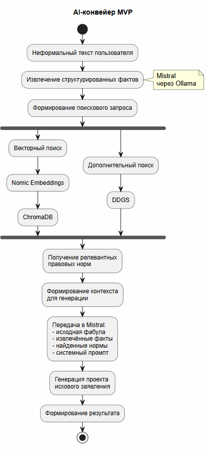

---

## Технологический стек MVP

| Компонент | Технология | Назначение |
| --- | --- | --- |
| LLM | Qwen 3.5 4B | Извлечение фактов, классификация намерений, генерация иска и ответы на вопросы |
| Запуск LLM | Ollama | Локальный запуск языковой модели |
| Embeddings | Nomic Embed Text | Формирование векторных представлений документов |
| Векторная БД | ChromaDB | Хранение и поиск фрагментов правовых документов |
| AI-пайплайн | LangChain | Загрузка, обработка и поиск документов |
| Backend API | FastAPI | Обработка HTTP-запросов |
| Валидация данных | Pydantic | Проверка и нормализация структурированных фактов |
| Шаблонизация | Jinja2 | Формирование текста искового заявления |
| Экспорт DOCX | python-docx | Создание редактируемого документа |
| База данных | SQLite | Хранение пользователей, сессий и истории чатов |
| Web search | DDGS | Поиск дополнительных правовых материалов |
| Frontend | React 19, TypeScript | Пользовательский веб-интерфейс |
| Сборка frontend | Vite | Разработка и сборка интерфейса |
| Контейнеризация | Docker, Docker Compose | Развертывание компонентов системы |

Значения конфигурации по умолчанию:

| Параметр | Значение по умолчанию |
| --- | --- |
| `LLM_MODEL` | `qwen3.5:4b` |
| `EMBEDDING_MODEL` | `nomic-embed-text` |
| `NUM_CTX` | `8192` |
| `CHUNK_SIZE` | `1000` |
| `CHUNK_OVERLAP` | `100` |
| `TOP_K_LOCAL` | `3` |
| `TOP_K_WEB` | `3` |
| `HISTORY_TURNS` | `8` |
| `MAX_MESSAGE_CHARS` | `8000` |
| `MIN_PASSWORD_LENGTH` | `6` (backend) |

Технологический стек может дополняться и изменяться по мере развития проекта.

---

## Работа с доказательствами

Пользовательская ситуация может предполагать наличие доказательств: фотографий, документов, чеков, договоров и других файлов.

При этом необходимо разделять:

1. **текстовое описание ситуации**, которое является основным входом текущего AI-конвейера;
2. **файлы доказательств**, которые могут быть связаны с делом.

На текущем этапе MVP автоматический анализ содержимого изображений и документов не является обязательной частью AI-конвейера.

Если в системе реализуется загрузка файлов, они могут сохраняться и связываться с соответствующим делом как доказательства.

Схема текущего MVP:

```
Текст пользователя
       ↓
AI-конвейер
       ↓
Проект иска
```

Дополнительный поток:

```
Файл доказательства
       ↓
Сохранение / привязка к делу
```

В дальнейшем может быть реализован отдельный AI-конвейер обработки доказательств:

```
Фото / PDF / документ
       ↓
OCR / Vision
       ↓
Извлеченные сведения
       ↓
Структурированные факты дела
       ↓
Генерация иска
```

Таким образом, наличие возможности прикреплять фотографии доказательств не противоречит текстовому POST-запросу: HTTP POST может передавать как текстовые данные, так и файлы. Однако автоматический анализ файлов должен рассматриваться как отдельное расширение функциональности, если он не реализован в текущем коде.

---

## Требования к API MVP

Основные endpoints:

| Метод | Endpoint | Назначение | Авторизация |
| --- | --- | --- | --- |
| POST | `/auth/register` | Регистрация пользователя | Нет |
| POST | `/auth/login` | Авторизация пользователя | Нет |
| GET | `/me` | Получение данных профиля | Bearer |
| POST | `/me/password` | Смена пароля | Bearer |
| DELETE | `/me` | Удаление аккаунта | Bearer |
| GET | `/chats` | Получение истории чатов | Bearer |
| PUT | `/chats/{chat_id}` | Сохранение чата | Bearer |
| DELETE | `/chats/{chat_id}` | Удаление чата | Bearer |
| POST | `/generate` | Генерация иска по тексту | Нет |
| POST | `/chat` | Обработка сообщения в чате | Нет |
| POST | `/export/docx` | Экспорт готового иска в DOCX | Нет |

Для `/generate` основной входной параметр:

```
{
  "text": "..."
}
```

Для `/generate` результат должен содержать как минимум:

```
{
  "facts": {},
  "isk": "...",
  "sources": []
}
```
Для `/chat` используется расширенная структура запроса:

```
{
  "message": "Дополнительная информация по делу...",
  "history": [
    {
      "role": "user",
      "content": "Первоначальное описание ситуации"
    },
    {
      "role": "assistant",
      "content": "Ответ системы"
    }
  ],
  "case": {},
  "draft": null,
  "force": false
}
```

Поля запроса:

* `message` — текущее сообщение пользователя;
* `history` — история последних сообщений диалога;
* `case` — ранее сформированное дело;
* `draft` — дополнительное поле запроса, которое сейчас передается в обработчик, но фактически не используется;
* `force` — также передается, но текущая логика его не использует.

`draft` и `force` не следует рассматривать как реализованные пользовательские возможности.

Важно: `/generate`, `/chat` и `/export/docx` в текущем `main.py` не защищены авторизацией. Bearer-токен проверяется для `/me` и `/chats`.
---

## Ограничения MVP

Текущая версия MVP имеет следующие ограничения:

1. Основной вход системы — неформальный текст пользователя.
2. Предметная область ограничена защитой прав потребителей.
3. Набор извлекаемых фактов ограничен предусмотренной структурой.
4. Классификация намерений опирается на LLM и эвристику для коротких вопросов; ошибочная классификация возможна.
5. Система не гарантирует юридическую корректность сформированного документа.
6. Сгенерированный документ требует проверки и, при необходимости, редактирования пользователем.
7. Автоматический анализ фотографий и других файлов доказательств не является обязательным компонентом текущего MVP.
8. Корпус документов находится на этапе формирования и расширения.
9. Точность генерации и устойчивость к галлюцинациям требуют дальнейшего тестирования.
10. Параметры моделей и эмбеддингов не считаются окончательными.
11. Полноценная автоматическая проверка юридической достаточности иска не входит в текущий MVP.
12. Доступность генерации зависит от работы Ollama и моделей; локальный поиск зависит от ChromaDB; веб-поиск — от DDGS.
13. Отдельный механизм автоматической юридической валидации актуальности и применимости найденных норм не реализован.

---

## Метод работы с AI-моделью

На текущем этапе используется локальная LLM Qwen 3.5 4B и RAG-подобный подход, при котором модель получает релевантный контекст из подготовленного корпуса документов.

При этом окончательная стратегия развития AI-компонента пока не фиксируется.

После формирования и анализа корпуса может быть рассмотрено использование:

* RAG;
* дообучения модели;
* комбинации RAG и дообучения;
* альтернативных моделей;
* различных embedding-моделей.

Выбор конкретного подхода должен основываться на результатах экспериментов с корпусом и требованиях к качеству генерации.

---

## Критерии готовности MVP

MVP считается работоспособным, если выполняются следующие условия:

### Входные данные

* пользователь может передать неформальное текстовое описание ситуации;
* API принимает текст через POST-запрос.
* пользователь может дополнять сведения о деле и задавать вопросы в чате.

### Обработка

* Qwen 3.5 4B извлекает из текста структурированные факты в схему `CaseFacts`;
* система классифицирует сообщение как `new_case`, `update` или `question`;
* при дополнении дела фабула объединяется с дополнением и генерация повторяется;
* при вопросе формируется ответ с учетом дела и доступных правовых материалов;
* система выполняет поиск релевантной правовой информации (локально и через веб-поиск);
* найденная информация передается в контекст генерации;
* Qwen 3.5 4B формирует проект искового заявления через `build_context` и шаблон `isk.j2`.

### Выходные данные

* `/generate` возвращает JSON с фактами, текстом иска и источниками;
* `/export/docx` формирует DOCX-файл из готового `context`;
* TXT формируется на frontend средствами браузера;
* текст иска можно скопировать через frontend.

### Техническая часть

* API запускается через FastAPI;
* необходимые компоненты AI-конвейера взаимодействуют между собой;
* векторный поиск работает на подготовленной базе;
* базовый пайплайн можно воспроизвести и протестировать.

---

## Связь MVP с дальнейшей архитектурой проекта

Текущий MVP является первым уровнем более полной системы формирования исковых заявлений.

В дальнейшем архитектура может быть расширена:

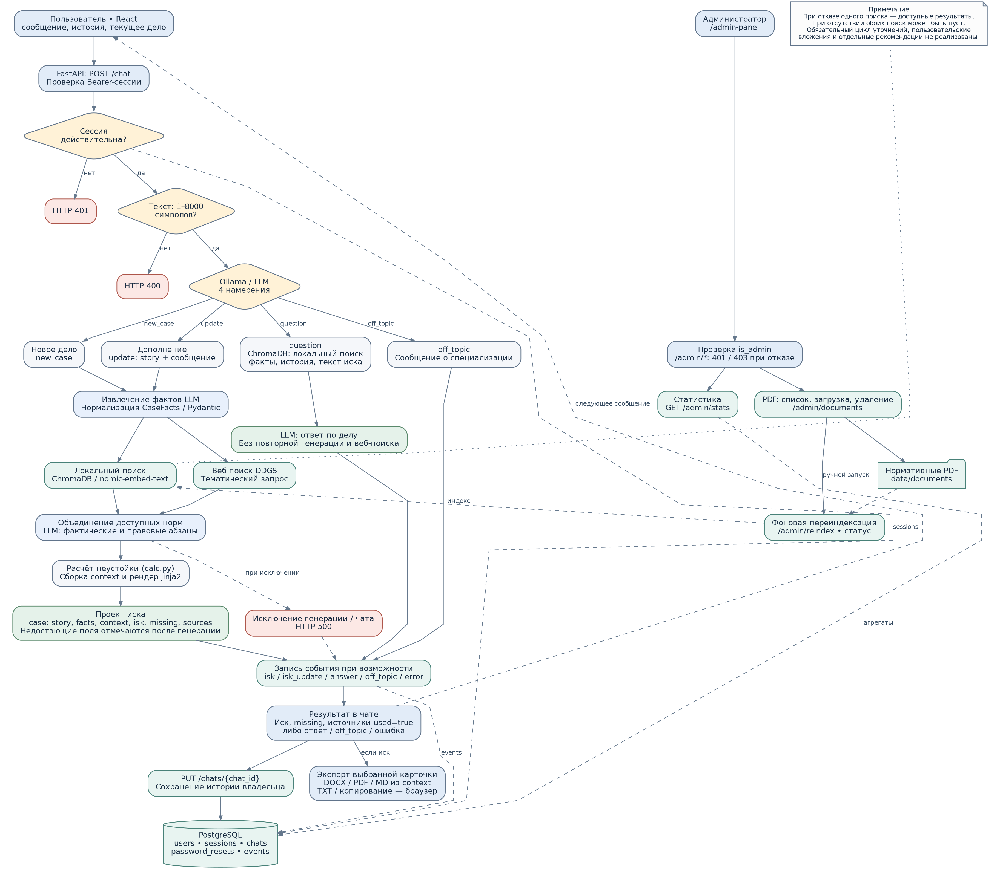

---

# JUSTICE - генератор исковых заявлений.
## ЭТАП 1

Проект представляет из себя систему для генерации исков по защите прав потребителей из неформального текста пользователя.

На данный момент создана основа проекта, работают основные эндпоинты генерации, сформирована векторная БД. После стабилизации базового пайплайна планируется настройка точности генерации и минимизация галлюцинаций путем сравнения различных вариантов эмбеддингов, моделей и их параметров. 

## Стек

- **Ollama** - локальная LLM (`mistral`) + эмбеддинги (`nomic`)
- **ChromaDB** - векторная база
- **LangChain** - пайплайн
- **FastAPI** - API-сервер
- **Docker** - контейнирезация
- **DDGS** - для поиска
- будет дополняться.

## Документы 

Делится на нормы и примеры исков ~74 страницы, будет дополняться.

## Стурктура проекта

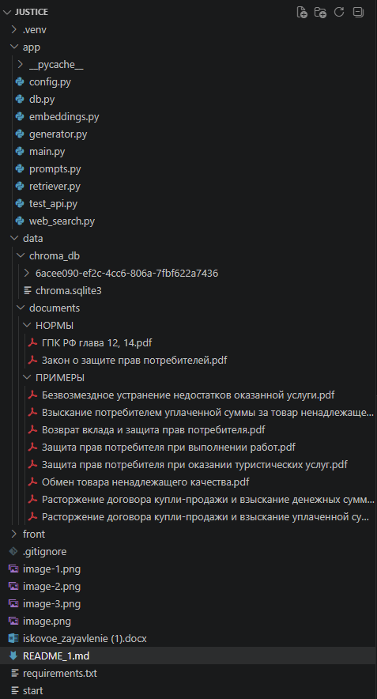

ПРИМЕР генерации в файле iskovoe-zayavlenie (1).docx.


## Описание использования

Пользователь отправляет неформальный текст о нарушении своих прав через POST-запрос на эндпоинт /generate, /generate/docx или /generate/txt. На первом шаге mistral извлекает из этого текста структурированные факты: истца, ответчика, предмет договора, цену, дату нарушения и требования. На втором шаге эти факты используются для поиска релевантных правовых норм через сформированную векторную БД и поиск DDGS. На третьем шаге модель получает исходную фабулу, найденные нормы и системный промпт с требованиями к структуре иска. На основе этих данных генерируется готовый текст искового заявления с шапкой, фабулой, правовым обоснованием и пр. В зависимости от эндпоинта результат возвращается либо в виде JSON для отладки, либо в виде готового файла .docx/.txt.

# Запросы 

- POST /generate — принимает JSON {"text": "..."}. Возвращает JSON с полями facts (извлечённые факты), isk (текст иска), sources (использованные нормы). Для отладки.
- POST /generate/docx — принимает JSON {"text": "..."}. Возвращает файл iskovoe_zayavlenie.docx для скачивания.
- POST /generate/txt — принимает JSON {"text": "..."}. Возвращает файл iskovoe_zayavlenie.txt для скачивания.

Пример работы (Swagger):

- Запрос к generate/docx: 

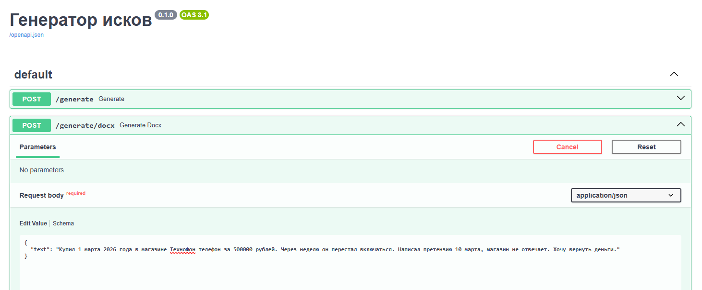

- Ответ:

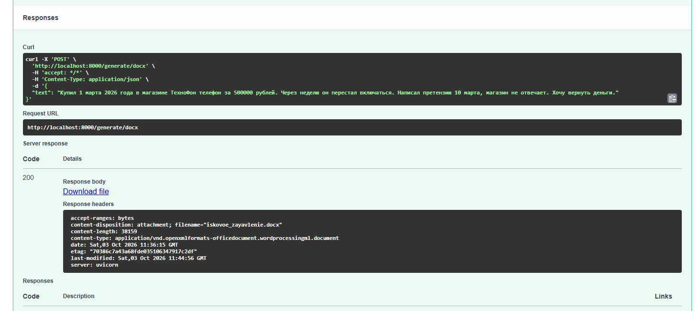

- Лог:

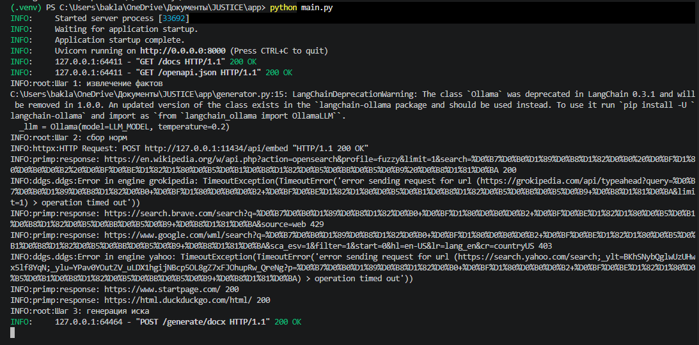


### * Исключены из репозитория:
Виртуальное окружение, кэш Python, векторная база, исходные PDF, секреты, логи.

--------------
Разработчик - Бакланова ЕС, ЭФМО-01-25

---

# Justice — фронтенд

Веб-интерфейс для генератора исковых заявлений **Justice**. Пользователь описывает ситуацию своими словами, а система на основе локальной LLM (Ollama + Mistral), векторной базы норм и веб-поиска готовит исковое заявление по защите прав потребителей.

Интерфейс сделан в привычном стиле чат-ассистента: одна строка ввода по центру, список чатов слева, профиль в левом нижнем углу.

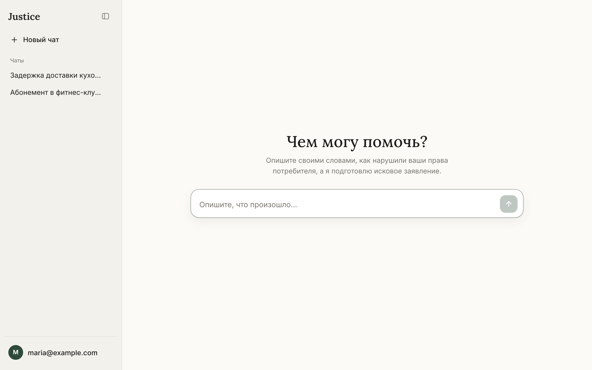

---

## Возможности

- **Вход и регистрация** по почте и паролю
- **Чат с генерацией иска**: строка ввода по центру, после первого сообщения опускается вниз
- **История чатов** в боковой панели: переключение, удаление, «Новый чат»
- **Готовый иск** можно скопировать или скачать в `.txt` и `.docx`
- **Профиль**: почта, дата регистрации, смена пароля, выбор темы, очистка истории, выход и удаление аккаунта
- **Светлая и тёмная тема** (или автоматически, как в системе)
- **Адаптивная вёрстка**: на телефоне боковая панель выезжает поверх
- **Понятные ошибки**: если не запущен бэкенд или Ollama, интерфейс прямо говорит, что включить

---

## Скриншоты

### Вход и регистрация

| Вход | Регистрация |
|---|---|
| 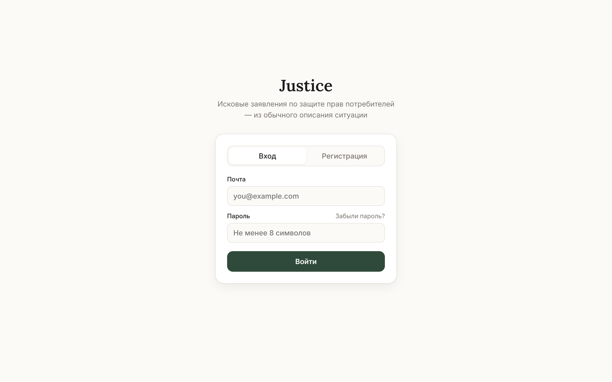 | 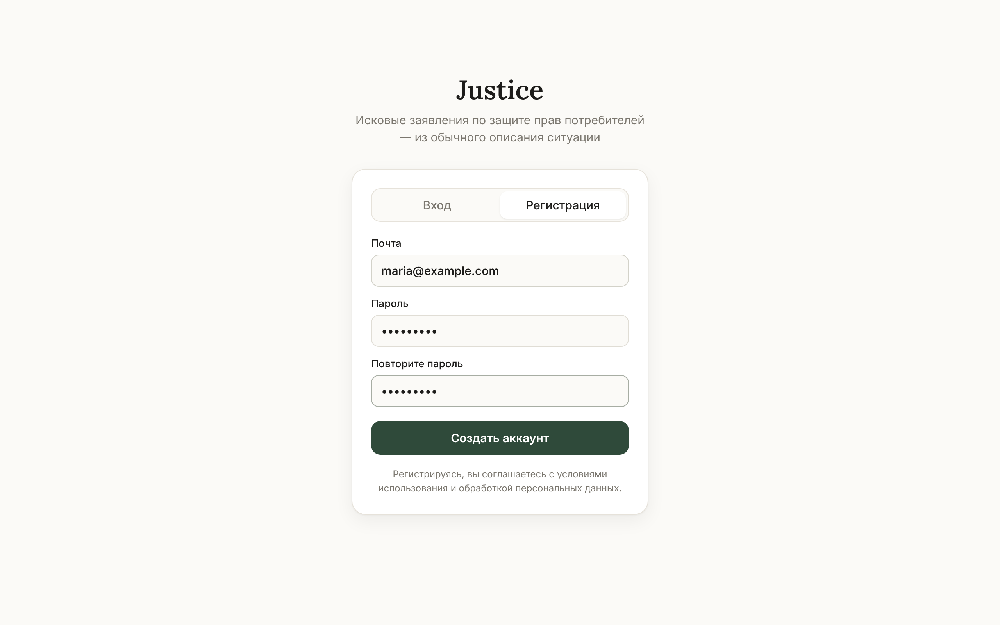 |

### Генерация иска

Пользователь описывает ситуацию, пока модель работает, в чате видно, что идёт обработка.

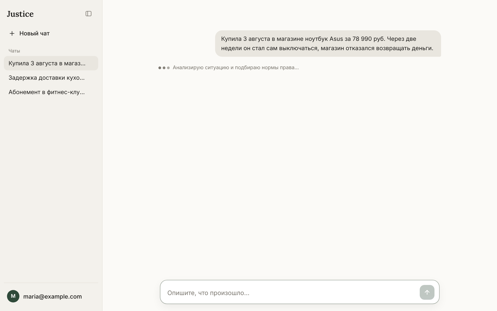

Готовое исковое заявление выводится карточкой. Под ним кнопки «Копировать», «Скачать .txt» и «Скачать .docx».

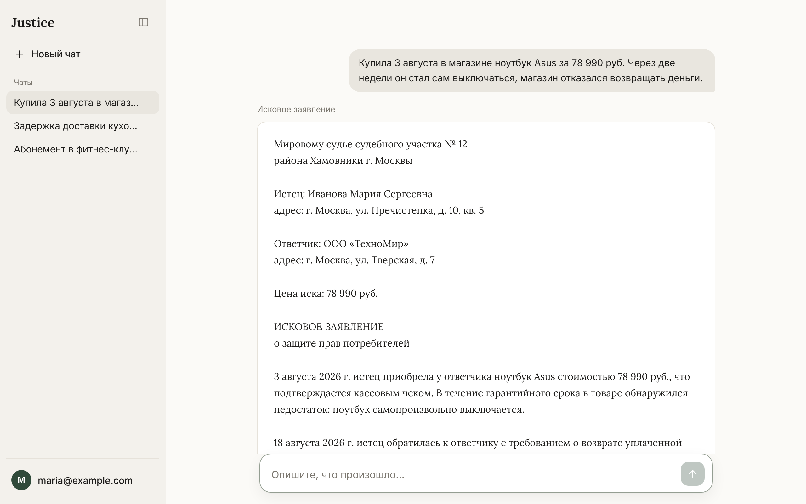

### Профиль

По клику на почту в левом нижнем углу открывается меню аккаунта.

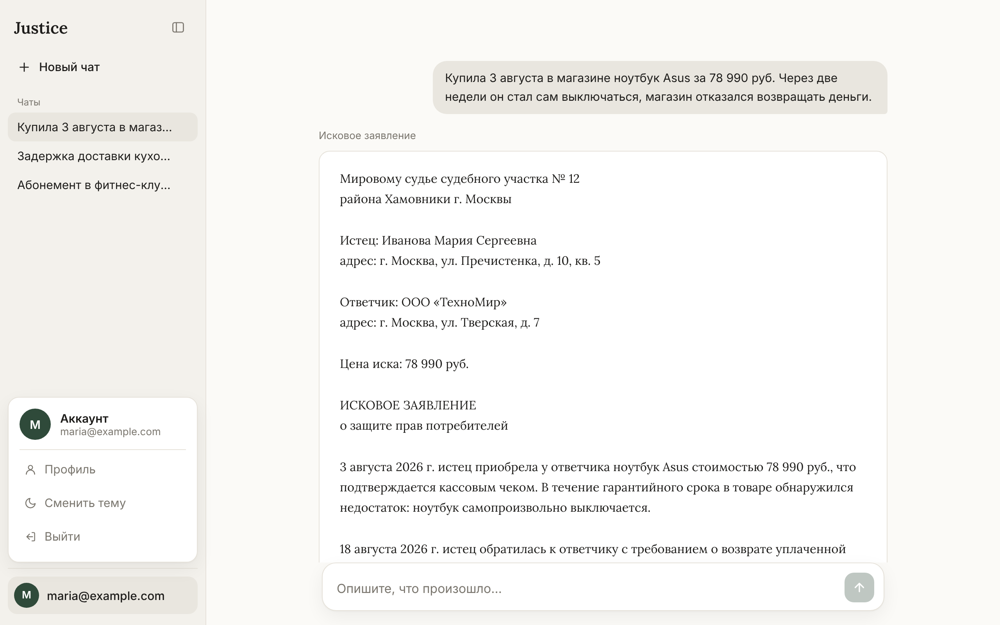

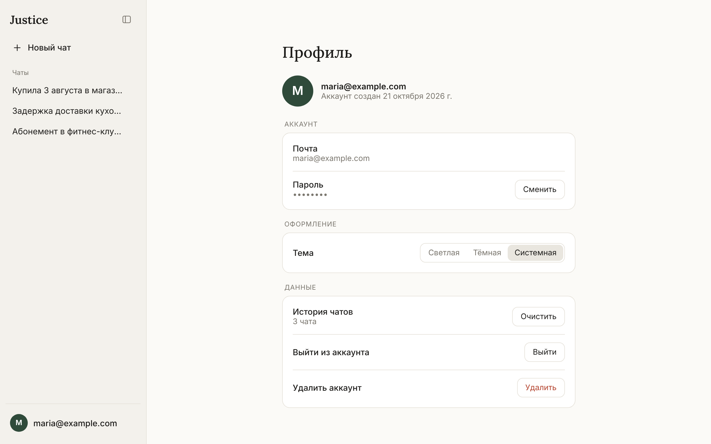

### Тёмная тема

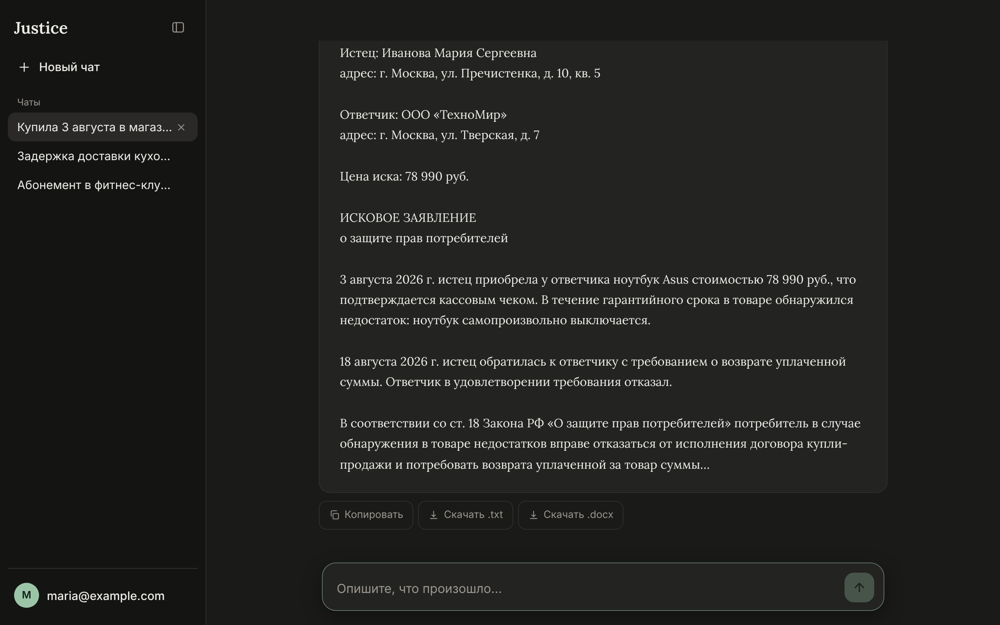

---

## Стек

- **React 19** + **TypeScript**
- **Vite**: сборка и dev-сервер
- **React Router**: страницы `/login`, `/`, `/c/:id`, `/profile`
- Стили на чистом CSS (без UI-библиотек), шрифты Inter и Lora

---

## Запуск

Нужны:
- **Node.js 18+**: [nodejs.org](https://nodejs.org)
- запущенный **бэкенд** (`app/main.py`) на порту 8000
- запущенная **Ollama** со скачанными моделями `mistral` и `nomic-embed-text`

Понадобятся два окна терминала.

**Терминал 1. Бэкенд**

macOS / Linux:
```bash
cd JUSTICE/app
source .venv/bin/activate
python main.py
```

Windows:
```powershell
cd JUSTICE\app
.venv\Scripts\activate
python main.py
```

Готово, когда появится `Uvicorn running on http://0.0.0.0:8000`.

**Терминал 2. Фронтенд**

```bash
cd JUSTICE/frontend
npm install      # только при первом запуске
npm run dev
```

Откройте в браузере **http://localhost:5173**.

Чтобы остановить любой сервер, нажмите `Ctrl + C` в его окне терминала.

### Как фронт связан с бэкендом

Dev-сервер Vite перенаправляет запросы `/generate`, `/auth`, `/me` на `http://127.0.0.1:8000` (см. `vite.config.ts`), поэтому настраивать CORS в FastAPI не нужно.

```
Браузер (5173) → Vite → FastAPI (8000) → Ollama (11434)
```

---

## Частые ошибки

| Сообщение в чате | Что делать |
|---|---|
| Бэкенд не отвечает. Запустите FastAPI… | Запустите `python main.py` в папке `app` и проверьте, что открывается http://127.0.0.1:8000/docs |
| Не запущена Ollama… | Откройте приложение Ollama или выполните `ollama serve`; проверка: http://127.0.0.1:11434 |
| Модель не скачана в Ollama… | `ollama pull mistral` и `ollama pull nomic-embed-text` |
| `address already in use` в терминале | Порт занят старым запуском: `lsof -ti :8000 \| xargs kill` (или `:5173`) |

Генерация идёт локально и занимает от одной до нескольких минут: модель делает два прохода (извлечение фактов и написание иска).

---

## Авторизация

Пока в бэкенде нет аккаунтов, в `.env` стоит `VITE_MOCK_AUTH=true`: регистрация и вход хранятся прямо в браузере. Этот режим только для разработки, пароли в нём не защищены.

Когда бэкенд будет готов, поставьте `VITE_MOCK_AUTH=false` и перезапустите `npm run dev`. Фронт ожидает такие эндпоинты:

| Метод | Путь | Тело запроса | Ответ |
|---|---|---|---|
| POST | `/auth/register` | `{email, password}` | `{access_token}` |
| POST | `/auth/login` | `{email, password}` | `{access_token}` |
| GET | `/me` | — | `{email, created_at}` |
| POST | `/me/password` | `{current_password, new_password}` | 204 |
| DELETE | `/me` | — | 204 |

Токен передаётся в заголовке `Authorization: Bearer <token>`. Ошибки ожидаются в формате FastAPI (`{"detail": "текст"}`), текст показывается пользователю как есть.

Генерация использует уже существующий эндпоинт:

| Метод | Путь | Тело запроса | Что берёт фронт |
|---|---|---|---|
| POST | `/generate` | `{text}` | поле `isk` |
| POST | `/generate/docx` | `{text}` | файл `.docx` |

---

## Сборка для продакшена

```bash
npm run build      # результат в frontend/dist
```

Чтобы FastAPI сам отдавал собранный фронт на том же адресе, добавьте в конец `app/main.py` (после всех API-эндпоинтов, перед `if __name__ == "__main__"`):

```python
from fastapi.staticfiles import StaticFiles
from fastapi.responses import FileResponse

DIST = os.path.join(os.path.dirname(__file__), "..", "frontend", "dist")
app.mount("/assets", StaticFiles(directory=os.path.join(DIST, "assets")), name="assets")

@app.get("/{path:path}", include_in_schema=False)
async def spa(path: str):
    # все остальные пути отдаём index.html — маршрутами занимается React
    return FileResponse(os.path.join(DIST, "index.html"))
```

После этого всё приложение открывается на http://localhost:8000.

---

## Структура

```
frontend/
├── index.html
├── vite.config.ts          прокси на бэкенд
├── .env                    VITE_MOCK_AUTH
└── src/
    ├── main.tsx            точка входа
    ├── App.tsx             маршруты и общий каркас (сайдбар + страница)
    ├── styles.css          все стили; цвета светлой и тёмной темы в начале файла
    ├── api/
    │   ├── client.ts       запросы к API, токен, понятные тексты ошибок
    │   ├── auth.ts         вход, регистрация, профиль (+ заглушка)
    │   └── generate.ts     /generate и /generate/docx
    ├── auth/
    │   └── AuthContext.tsx текущий пользователь
    ├── components/
    │   ├── Sidebar.tsx     список чатов
    │   ├── ProfileMenu.tsx меню профиля в левом нижнем углу
    │   ├── Composer.tsx    строка ввода
    │   ├── MessageView.tsx сообщения и карточка иска
    │   ├── Avatar.tsx
    │   └── Icons.tsx
    ├── lib/
    │   ├── ChatsContext.tsx история чатов
    │   ├── theme.ts        светлая / тёмная / системная тема
    │   ├── storage.ts      безопасная работа с localStorage
    │   └── format.ts       даты, склонения, скачивание файлов
    └── pages/
        ├── LoginPage.tsx
        ├── ChatPage.tsx
        └── ProfilePage.tsx
```

---

## Ограничения и планы

- История чатов хранится в браузере, отдельно для каждого пользователя. Чтобы перенести её на сервер, нужно поменять только `src/lib/ChatsContext.tsx`.
- Кнопка «Скачать .docx» вызывает `/generate/docx`, который генерирует иск заново, поэтому файл может отличаться от текста на экране. Лучше добавить в бэкенд эндпоинт, превращающий готовый текст в `.docx`.
- «Забыли пароль?» и смена почты требуют отправки писем и пока не реализованы.
- Ответ приходит целиком. Потоковый вывод (по мере генерации) появится, если бэкенд начнёт отдавать ответ через streaming.
