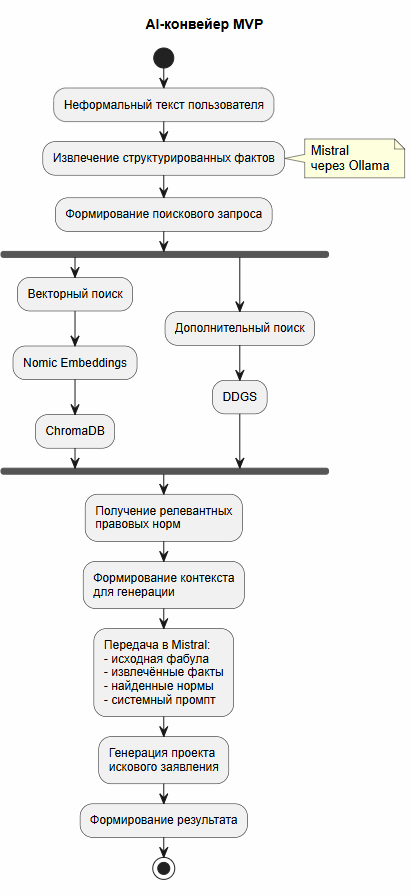
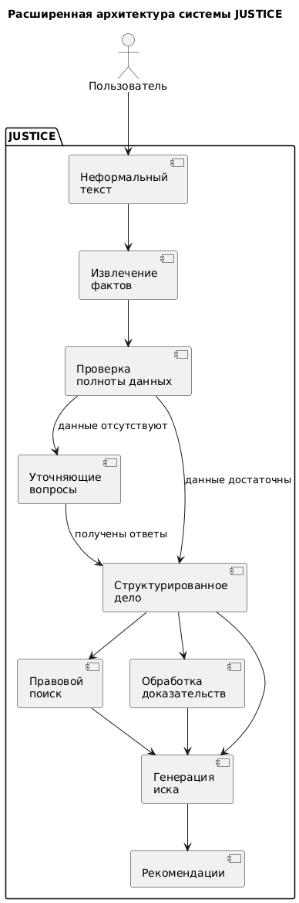
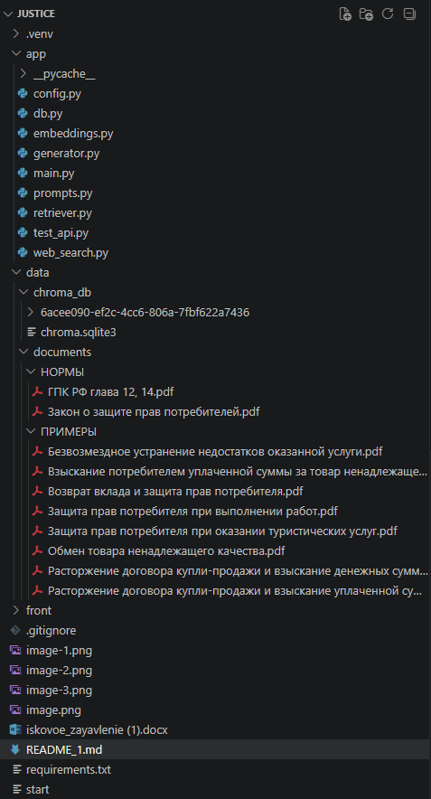
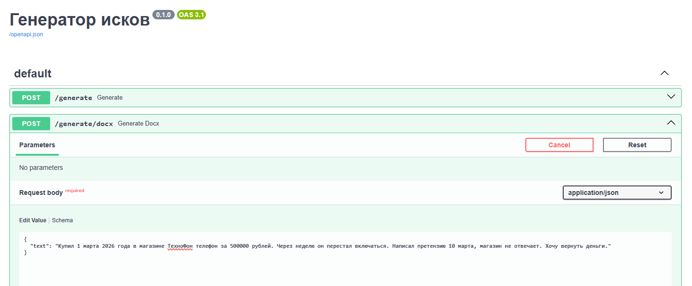
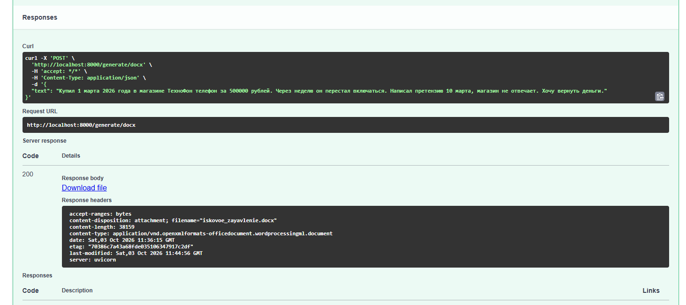
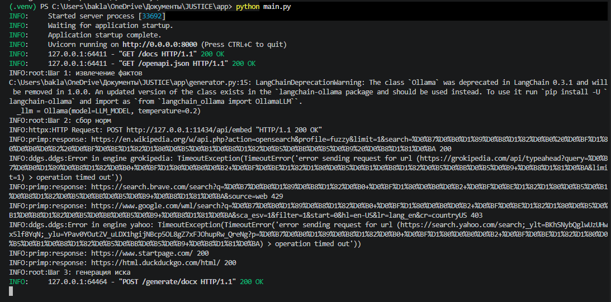
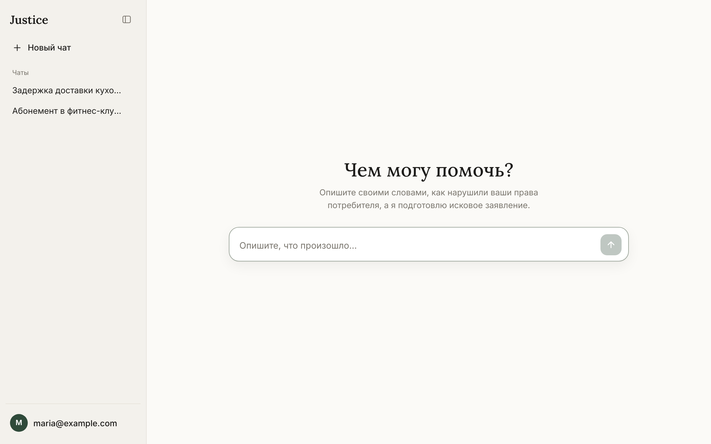
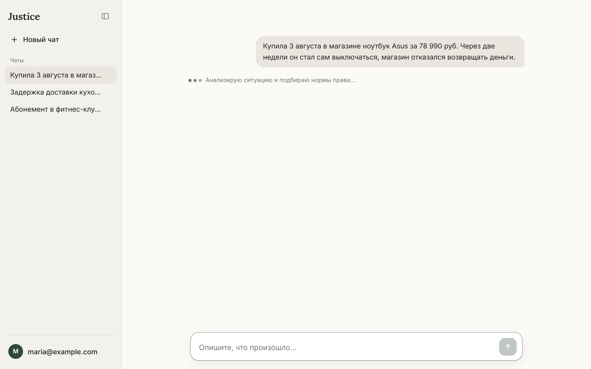
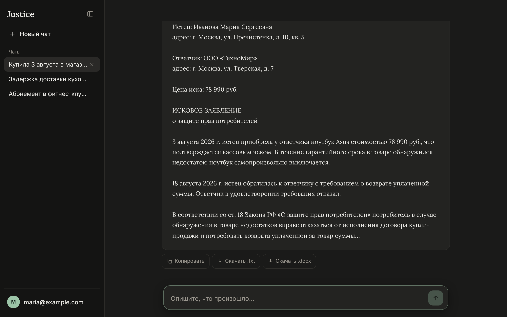

# MVP — генеративная система формирования исковых заявлений

## Назначение MVP

MVP (Minimum Viable Product) представляет собой минимально работоспособную версию системы для автоматизированного формирования проектов исковых заявлений по делам о защите прав потребителей.

На текущем этапе система принимает неформальное текстовое описание ситуации от пользователя, извлекает из него основные юридически значимые факты, осуществляет поиск релевантных правовых норм и на их основе генерирует проект искового заявления.

Основная задача MVP — проверить работоспособность базового AI-конвейера от исходного текста пользователя до готового проекта искового заявления.

---

## Цель MVP

Цель MVP — реализовать и проверить следующий базовый сценарий:

> **Неформальное описание ситуации → извлечение фактов → поиск правовых норм → генерация искового заявления → выдача результата.**

MVP должен позволять получить связный проект искового заявления на основании предоставленной пользователем фабулы дела.

На данном этапе основной предметной областью являются **споры о защите прав потребителей**.

---

## Пользователь MVP

Основным пользователем MVP является человек, который хочет сформировать проект искового заявления по ситуации, связанной с нарушением его прав как потребителя.

Пользователь не обязан самостоятельно формулировать исковое заявление в юридическом стиле. Он предоставляет системе описание ситуации в свободной форме.

Например:

> «Я купил телефон в магазине, через два месяца он перестал работать. Магазин отказался вернуть деньги и предложил только ремонт...»

Система должна преобразовать такое описание в структурированные факты и использовать их для формирования проекта иска.

---

## Основной пользовательский сценарий

### Шаг 1. Формирование описания ситуации

Пользователь формирует неформальное текстовое описание произошедшей ситуации.

Текст может содержать:

* информацию о заявителе;
* информацию о продавце или исполнителе;
* описание товара или услуги;
* сведения о договоре;
* стоимость товара или услуги;
* даты;
* обстоятельства нарушения;
* требования пользователя;
* иные сведения, которые пользователь считает важными.

На текущем этапе пользователь передает информацию одним текстовым сообщением.

---

### Шаг 2. Отправка запроса

Исходный текст передается на backend через HTTP POST-запрос.

Основной endpoint:

```
POST /generate
```

Формат входных данных:

```
{
  "text": "Неформальное описание ситуации пользователя"
}
```

Также предусмотрены endpoints для получения готового документа:

```
POST /generate/docx
POST /generate/txt
```

Они принимают тот же исходный текст.

---

## Извлечение структурированных фактов

На первом этапе AI-модель обрабатывает исходный неформальный текст.

Для извлечения фактов используется локальная LLM **Mistral**, запускаемая через **Ollama**.

Из исходной фабулы система пытается выделить основные сведения, необходимые для дальнейшего формирования иска.

В MVP предусматривается извлечение, в частности:

* истца;
* ответчика;
* предмета договора;
* товара или услуги;
* цены;
* даты нарушения;
* требований пользователя;
* иных значимых фактов, присутствующих в исходном тексте.

Результатом этапа является структурированное представление фактов, которое используется на следующих этапах обработки.

Схематично:

```
Неформальный текст
        ↓
       Mistral
        ↓
Структурированные факты
```

---

## Поиск релевантных правовых норм

После извлечения фактов система выполняет поиск информации, которая может использоваться в правовом обосновании иска.

Для этого применяется комбинация:

* векторной базы **ChromaDB**;
* эмбеддингов **Nomic**;
* пайплайна **LangChain**;
* поиска **DDGS**.

Векторная база содержит подготовленные документы, включающие нормы законодательства и примеры исковых заявлений.

На текущем этапе корпус составляет около 74 страниц и планируется к дальнейшему расширению.

Общая схема:


```
Структурированные факты
        ↓
Формирование поискового запроса
        ↓
ChromaDB + Nomic
        +
      DDGS
        ↓
Релевантные правовые нормы
```

---

## Использование корпуса документов

Корпус документов на текущем этапе разделяется на два основных типа:

1. правовые нормы;
2. примеры исковых заявлений.

Документы используются для обеспечения модели контекстом, необходимым для формирования искового заявления.

Корпус является развивающимся компонентом проекта и в дальнейшем должен быть расширен.

В MVP не фиксируется окончательный объем корпуса, поскольку его состав и качество будут уточняться в процессе разработки и тестирования системы.

---

## Генерация искового заявления

На третьем этапе система передает модели:

* исходную фабулу пользователя;
* извлеченные факты;
* найденные правовые нормы;
* системный промпт с требованиями к структуре и содержанию искового заявления.

На основе этих данных модель формирует проект искового заявления.

Общая схема:

```
Исходная фабула
       +
Извлеченные факты
       +
Найденные правовые нормы
       +
Системный промпт
       ↓
      Mistral
       ↓
Проект искового заявления
```

В результате формируется текст, содержащий основные элементы искового заявления, в том числе:

* сведения о сторонах;
* описание обстоятельств дела;
* правовое обоснование;
* требования;
* иные необходимые структурные элементы.

Конкретная структура генерируемого документа уточняется по мере тестирования системы и анализа примеров исков.

---

## Форматы результата

MVP предусматривает несколько вариантов получения результата.

### JSON

Endpoint:

```
POST /generate
```

Возвращает структурированные данные для отладки и проверки работы AI-конвейера.

Пример структуры:

```
{
  "facts": {},
  "isk": "...",
  "sources": []
}
```

Где:

* `facts` — извлеченные из исходного текста факты;
* `isk` — сгенерированный текст искового заявления;
* `sources` — использованные правовые нормы и источники.

JSON-ответ используется преимущественно для отладки и анализа качества работы отдельных этапов системы.

---

### DOCX

Endpoint:

```
POST /generate/docx
```

Возвращает готовый файл:

```
iskovoe_zayavlenie.docx
```

Формат предназначен для получения пользователем документа, который можно открыть и дополнительно редактировать.

---

### TXT

Endpoint:

```
POST /generate/txt
```

Возвращает текстовый файл:

```
iskovoe_zayavlenie.txt
```

Данный формат может использоваться для упрощенного получения и дальнейшей обработки результата.

---

## Архитектура AI-конвейера MVP



---

## Технологический стек MVP

| Компонент       | Технология | Назначение                               |
| --------------- | ---------- | ---------------------------------------- |
| LLM             | Mistral    | Извлечение фактов и генерация иска       |
| Запуск LLM      | Ollama     | Локальный запуск модели                  |
| Embeddings      | Nomic      | Формирование векторных представлений     |
| Векторная БД    | ChromaDB   | Хранение и поиск релевантных документов  |
| AI-пайплайн     | LangChain  | Организация последовательности обработки |
| API             | FastAPI    | Реализация HTTP API                      |
| Контейнеризация | Docker     | Развертывание компонентов системы        |
| Web search      | DDGS       | Дополнительный поиск правовой информации |

Технологический стек может дополняться и изменяться по мере развития проекта.

---

## Работа с доказательствами

Пользовательская ситуация может предполагать наличие доказательств: фотографий, документов, чеков, договоров и других файлов.

При этом необходимо разделять:

1. **текстовое описание ситуации**, которое является основным входом текущего AI-конвейера;
2. **файлы доказательств**, которые могут быть связаны с делом.

На текущем этапе MVP автоматический анализ содержимого изображений и документов не является обязательной частью AI-конвейера.

Если в системе реализуется загрузка файлов, они могут сохраняться и связываться с соответствующим делом как доказательства.

Схема текущего MVP:

```
Текст пользователя
       ↓
AI-конвейер
       ↓
Проект иска
```

Дополнительный поток:

```
Файл доказательства
       ↓
Сохранение / привязка к делу
```

В дальнейшем может быть реализован отдельный AI-конвейер обработки доказательств:

```
Фото / PDF / документ
       ↓
OCR / Vision
       ↓
Извлеченные сведения
       ↓
Структурированные факты дела
       ↓
Генерация иска
```

Таким образом, наличие возможности прикреплять фотографии доказательств не противоречит текстовому POST-запросу: HTTP POST может передавать как текстовые данные, так и файлы. Однако автоматический анализ файлов должен рассматриваться как отдельное расширение функциональности, если он не реализован в текущем коде.

---

## Требования к API MVP

Основные endpoints:

| Метод | Endpoint         | Назначение                                 |
| ----- | ---------------- | ------------------------------------------ |
| POST  | `/generate`      | Генерация иска и возврат результата в JSON |
| POST  | `/generate/docx` | Генерация иска и возврат DOCX              |
| POST  | `/generate/txt`  | Генерация иска и возврат TXT               |

Основной входной параметр:

```
{
  "text": "..."
}
```

Для `/generate` результат должен содержать как минимум:

```
{
  "facts": {},
  "isk": "...",
  "sources": []
}
```

---

## Ограничения MVP

Текущая версия MVP имеет следующие ограничения:

1. Основной вход системы — неформальный текст пользователя.
2. Предметная область ограничена защитой прав потребителей.
3. Набор извлекаемых фактов ограничен предусмотренной структурой.
4. Система не гарантирует юридическую корректность сформированного документа.
5. Сгенерированный документ требует проверки и, при необходимости, редактирования пользователем.
6. Автоматический анализ фотографий и других файлов доказательств не является обязательным компонентом текущего MVP.
7. Корпус документов находится на этапе формирования и расширения.
8. Точность генерации и устойчивость к галлюцинациям требуют дальнейшего тестирования.
9. Параметры моделей и эмбеддингов не считаются окончательными.
10. Полноценная автоматическая проверка юридической достаточности иска не входит в текущий MVP.

---

## Что не входит в текущий MVP

Следующие функции рассматриваются как дальнейшее развитие системы:

* автоматическая поддержка большого количества категорий споров;
* полноценный диалог с пользователем для получения недостающей информации;
* автоматическое определение всех типов недостающих данных;
* автоматический анализ фотографий доказательств;
* OCR документов;
* анализ изображений с помощью Vision-моделей;
* полноценная автоматическая проверка юридической корректности иска;
* автоматический подбор суда и подсудности;
* автоматическое определение государственной пошлины;
* интеграция с внешними государственными информационными системами;
* полноценный пользовательский личный кабинет;
* расширенная история документов;
* автоматическая отправка иска в суд.

Эти функции могут быть включены в последующие версии системы после стабилизации базового AI-конвейера.

---

## Метод работы с AI-моделью

На текущем этапе используется локальная LLM Mistral и RAG-подобный подход, при котором модель получает релевантный контекст из подготовленного корпуса документов.

При этом окончательная стратегия развития AI-компонента пока не фиксируется.

После формирования и анализа корпуса может быть рассмотрено использование:

* RAG;
* дообучения модели;
* комбинации RAG и дообучения;
* альтернативных моделей;
* различных embedding-моделей.

Выбор конкретного подхода должен основываться на результатах экспериментов с корпусом и требованиях к качеству генерации.

---

## Критерии готовности MVP

MVP считается работоспособным, если выполняются следующие условия:

### Входные данные

* пользователь может передать неформальное текстовое описание ситуации;
* API принимает текст через POST-запрос.

### Обработка

* Mistral извлекает из текста структурированные факты;
* система выполняет поиск релевантной правовой информации;
* найденная информация передается в контекст генерации;
* Mistral формирует проект искового заявления.

### Выходные данные

* `/generate` возвращает JSON с фактами, текстом иска и источниками;
* `/generate/docx` формирует DOCX-файл;
* `/generate/txt` формирует TXT-файл.

### Техническая часть

* API запускается через FastAPI;
* необходимые компоненты AI-конвейера взаимодействуют между собой;
* векторный поиск работает на подготовленной базе;
* базовый пайплайн можно воспроизвести и протестировать.

---

## Связь MVP с дальнейшей архитектурой проекта

Текущий MVP является первым уровнем более полной системы формирования исковых заявлений.

В дальнейшем архитектура может быть расширена:



---

# JUSTICE - генератор исковых заявлений.
## ЭТАП 1

Проект представляет из себя систему для генерации исков по защите прав потребителей из неформального текста пользователя.

На данный момент создана основа проекта, работают основные эндпоинты генерации, сформирована векторная БД. После стабилизации базового пайплайна планируется настройка точности генерации и минимизация галлюцинаций путем сравнения различных вариантов эмбеддингов, моделей и их параметров. 

## Стек

- **Ollama** - локальная LLM (`mistral`) + эмбеддинги (`nomic`)
- **ChromaDB** - векторная база
- **LangChain** - пайплайн
- **FastAPI** - API-сервер
- **Docker** - контейнирезация
- **DDGS** - для поиска
- будет дополняться.

## Документы 

Делится на нормы и примеры исков ~74 страницы, будет дополняться.

## Стурктура проекта



ПРИМЕР генерации в файле iskovoe-zayavlenie (1).docx.


## Описание использования

Пользователь отправляет неформальный текст о нарушении своих прав через POST-запрос на эндпоинт /generate, /generate/docx или /generate/txt. На первом шаге mistral извлекает из этого текста структурированные факты: истца, ответчика, предмет договора, цену, дату нарушения и требования. На втором шаге эти факты используются для поиска релевантных правовых норм через сформированную векторную БД и поиск DDGS. На третьем шаге модель получает исходную фабулу, найденные нормы и системный промпт с требованиями к структуре иска. На основе этих данных генерируется готовый текст искового заявления с шапкой, фабулой, правовым обоснованием и пр. В зависимости от эндпоинта результат возвращается либо в виде JSON для отладки, либо в виде готового файла .docx/.txt.

# Запросы 

- POST /generate — принимает JSON {"text": "..."}. Возвращает JSON с полями facts (извлечённые факты), isk (текст иска), sources (использованные нормы). Для отладки.
- POST /generate/docx — принимает JSON {"text": "..."}. Возвращает файл iskovoe_zayavlenie.docx для скачивания.
- POST /generate/txt — принимает JSON {"text": "..."}. Возвращает файл iskovoe_zayavlenie.txt для скачивания.

Пример работы (Swagger):

- Запрос к generate/docx: 



- Ответ:



- Лог:




### * Исключены из репозитория:
Виртуальное окружение, кэш Python, векторная база, исходные PDF, секреты, логи.

--------------
Разработчик - Бакланова ЕС, ЭФМО-01-25

---

# Justice — фронтенд

Веб-интерфейс для генератора исковых заявлений **Justice**. Пользователь описывает ситуацию своими словами, а система на основе локальной LLM (Ollama + Mistral), векторной базы норм и веб-поиска готовит исковое заявление по защите прав потребителей.

Интерфейс сделан в привычном стиле чат-ассистента: одна строка ввода по центру, список чатов слева, профиль в левом нижнем углу.



---

## Возможности

- **Вход и регистрация** по почте и паролю
- **Чат с генерацией иска**: строка ввода по центру, после первого сообщения опускается вниз
- **История чатов** в боковой панели: переключение, удаление, «Новый чат»
- **Готовый иск** можно скопировать или скачать в `.txt` и `.docx`
- **Профиль**: почта, дата регистрации, смена пароля, выбор темы, очистка истории, выход и удаление аккаунта
- **Светлая и тёмная тема** (или автоматически, как в системе)
- **Адаптивная вёрстка**: на телефоне боковая панель выезжает поверх
- **Понятные ошибки**: если не запущен бэкенд или Ollama, интерфейс прямо говорит, что включить

---

## Скриншоты

### Вход и регистрация

| Вход | Регистрация |
|---|---|
|  |  |

### Генерация иска

Пользователь описывает ситуацию, пока модель работает, в чате видно, что идёт обработка.



Готовое исковое заявление выводится карточкой. Под ним кнопки «Копировать», «Скачать .txt» и «Скачать .docx».


### Профиль

По клику на почту в левом нижнем углу открывается меню аккаунта.


### Тёмная тема



---

## Стек

- **React 19** + **TypeScript**
- **Vite**: сборка и dev-сервер
- **React Router**: страницы `/login`, `/`, `/c/:id`, `/profile`
- Стили на чистом CSS (без UI-библиотек), шрифты Inter и Lora

---

## Запуск

Нужны:
- **Node.js 18+**: [nodejs.org](https://nodejs.org)
- запущенный **бэкенд** (`app/main.py`) на порту 8000
- запущенная **Ollama** со скачанными моделями `mistral` и `nomic-embed-text`

Понадобятся два окна терминала.

**Терминал 1. Бэкенд**

macOS / Linux:
```bash
cd JUSTICE/app
source .venv/bin/activate
python main.py
```

Windows:
```powershell
cd JUSTICE\app
.venv\Scripts\activate
python main.py
```

Готово, когда появится `Uvicorn running on http://0.0.0.0:8000`.

**Терминал 2. Фронтенд**

```bash
cd JUSTICE/frontend
npm install      # только при первом запуске
npm run dev
```

Откройте в браузере **http://localhost:5173**.

Чтобы остановить любой сервер, нажмите `Ctrl + C` в его окне терминала.

### Как фронт связан с бэкендом

Dev-сервер Vite перенаправляет запросы `/generate`, `/auth`, `/me` на `http://127.0.0.1:8000` (см. `vite.config.ts`), поэтому настраивать CORS в FastAPI не нужно.

```
Браузер (5173) → Vite → FastAPI (8000) → Ollama (11434)
```

---

## Частые ошибки

| Сообщение в чате | Что делать |
|---|---|
| Бэкенд не отвечает. Запустите FastAPI… | Запустите `python main.py` в папке `app` и проверьте, что открывается http://127.0.0.1:8000/docs |
| Не запущена Ollama… | Откройте приложение Ollama или выполните `ollama serve`; проверка: http://127.0.0.1:11434 |
| Модель не скачана в Ollama… | `ollama pull mistral` и `ollama pull nomic-embed-text` |
| `address already in use` в терминале | Порт занят старым запуском: `lsof -ti :8000 \| xargs kill` (или `:5173`) |

Генерация идёт локально и занимает от одной до нескольких минут: модель делает два прохода (извлечение фактов и написание иска).

---

## Авторизация

Пока в бэкенде нет аккаунтов, в `.env` стоит `VITE_MOCK_AUTH=true`: регистрация и вход хранятся прямо в браузере. Этот режим только для разработки, пароли в нём не защищены.

Когда бэкенд будет готов, поставьте `VITE_MOCK_AUTH=false` и перезапустите `npm run dev`. Фронт ожидает такие эндпоинты:

| Метод | Путь | Тело запроса | Ответ |
|---|---|---|---|
| POST | `/auth/register` | `{email, password}` | `{access_token}` |
| POST | `/auth/login` | `{email, password}` | `{access_token}` |
| GET | `/me` | — | `{email, created_at}` |
| POST | `/me/password` | `{current_password, new_password}` | 204 |
| DELETE | `/me` | — | 204 |

Токен передаётся в заголовке `Authorization: Bearer <token>`. Ошибки ожидаются в формате FastAPI (`{"detail": "текст"}`), текст показывается пользователю как есть.

Генерация использует уже существующий эндпоинт:

| Метод | Путь | Тело запроса | Что берёт фронт |
|---|---|---|---|
| POST | `/generate` | `{text}` | поле `isk` |
| POST | `/generate/docx` | `{text}` | файл `.docx` |

---

## Сборка для продакшена

```bash
npm run build      # результат в frontend/dist
```

Чтобы FastAPI сам отдавал собранный фронт на том же адресе, добавьте в конец `app/main.py` (после всех API-эндпоинтов, перед `if __name__ == "__main__"`):

```python
from fastapi.staticfiles import StaticFiles
from fastapi.responses import FileResponse

DIST = os.path.join(os.path.dirname(__file__), "..", "frontend", "dist")
app.mount("/assets", StaticFiles(directory=os.path.join(DIST, "assets")), name="assets")

@app.get("/{path:path}", include_in_schema=False)
async def spa(path: str):
    # все остальные пути отдаём index.html — маршрутами занимается React
    return FileResponse(os.path.join(DIST, "index.html"))
```

После этого всё приложение открывается на http://localhost:8000.

---

## Структура

```
frontend/
├── index.html
├── vite.config.ts          прокси на бэкенд
├── .env                    VITE_MOCK_AUTH
└── src/
    ├── main.tsx            точка входа
    ├── App.tsx             маршруты и общий каркас (сайдбар + страница)
    ├── styles.css          все стили; цвета светлой и тёмной темы в начале файла
    ├── api/
    │   ├── client.ts       запросы к API, токен, понятные тексты ошибок
    │   ├── auth.ts         вход, регистрация, профиль (+ заглушка)
    │   └── generate.ts     /generate и /generate/docx
    ├── auth/
    │   └── AuthContext.tsx текущий пользователь
    ├── components/
    │   ├── Sidebar.tsx     список чатов
    │   ├── ProfileMenu.tsx меню профиля в левом нижнем углу
    │   ├── Composer.tsx    строка ввода
    │   ├── MessageView.tsx сообщения и карточка иска
    │   ├── Avatar.tsx
    │   └── Icons.tsx
    ├── lib/
    │   ├── ChatsContext.tsx история чатов
    │   ├── theme.ts        светлая / тёмная / системная тема
    │   ├── storage.ts      безопасная работа с localStorage
    │   └── format.ts       даты, склонения, скачивание файлов
    └── pages/
        ├── LoginPage.tsx
        ├── ChatPage.tsx
        └── ProfilePage.tsx
```

---

## Ограничения и планы

- История чатов хранится в браузере, отдельно для каждого пользователя. Чтобы перенести её на сервер, нужно поменять только `src/lib/ChatsContext.tsx`.
- Кнопка «Скачать .docx» вызывает `/generate/docx`, который генерирует иск заново, поэтому файл может отличаться от текста на экране. Лучше добавить в бэкенд эндпоинт, превращающий готовый текст в `.docx`.
- «Забыли пароль?» и смена почты требуют отправки писем и пока не реализованы.
- Ответ приходит целиком. Потоковый вывод (по мере генерации) появится, если бэкенд начнёт отдавать ответ через streaming.