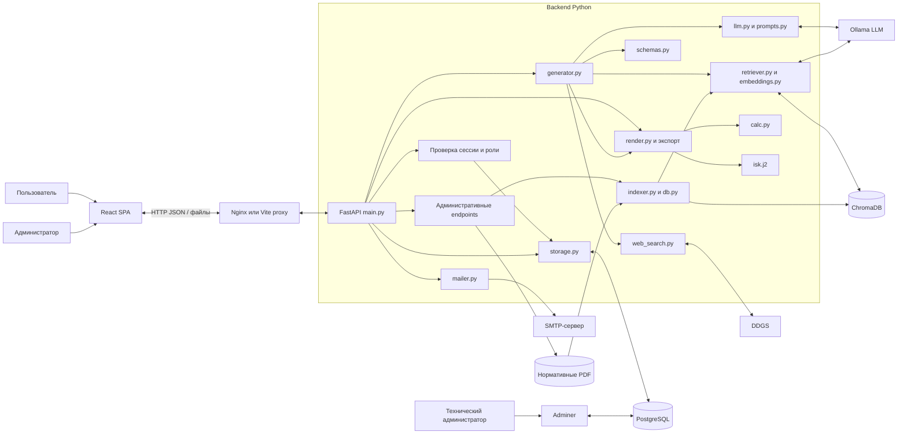
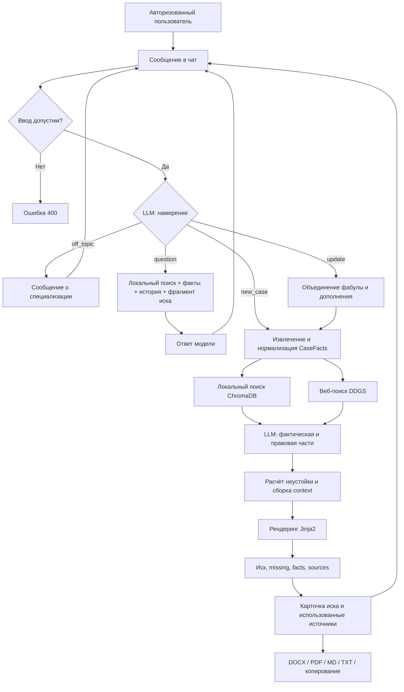
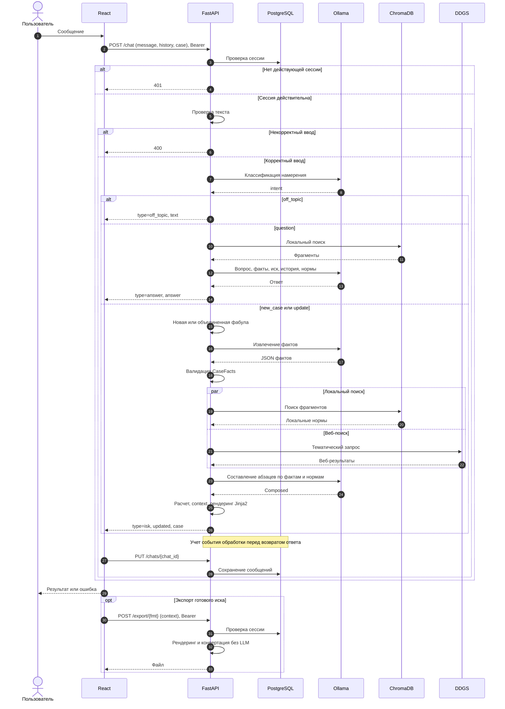
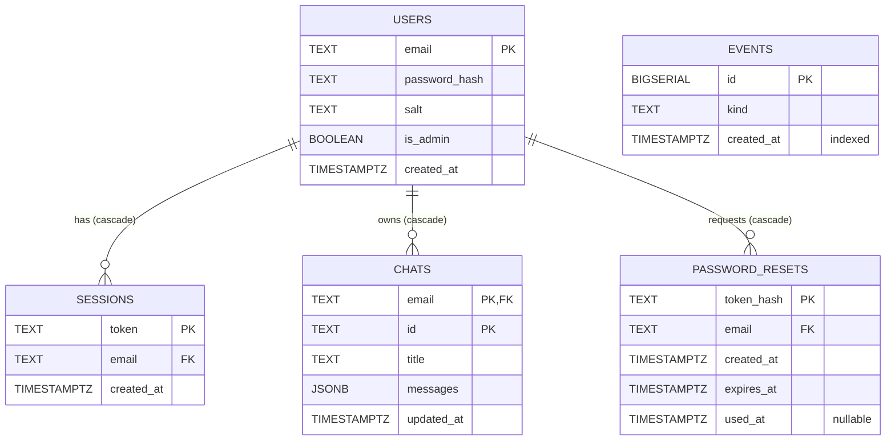
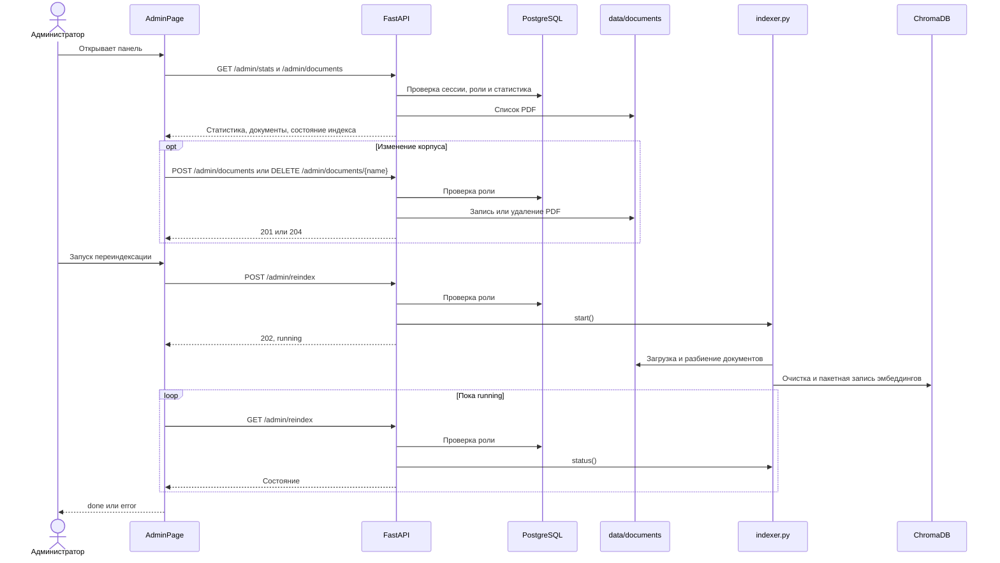
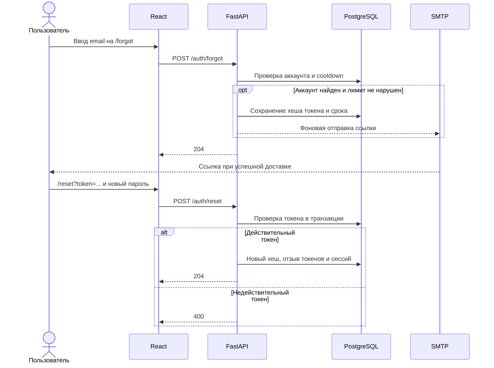
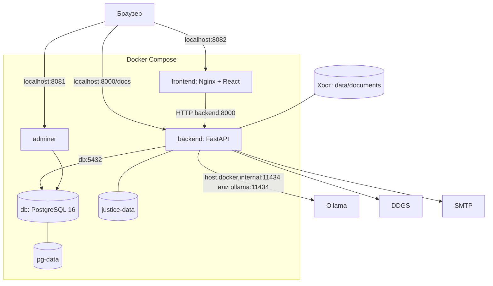

# Архитектура системы JUSTICE

## 1. Назначение и границы системы

JUSTICE — клиент-серверная веб-система подготовки проектов исковых заявлений по защите прав потребителей на основе обработки свободного русскоязычного текста. Архитектура объединяет локальную языковую модель, поиск правовой информации, детерминированную обработку данных и шаблонное формирование документов. 

Основные акторы: пользователь и администратор. Последний имеет дополнительные права управления нормативным корпусом и просмотра статистики. Внешние зависимости — Ollama, DDGS и SMTP; PostgreSQL и ChromaDB являются хранилищами системы. Судебные системы, отправка исков, платежные системы, OCR и пользовательские файловые доказательства не интегрированы.

## 2. Архитектурные решения

| Решение | Реализация | Обоснование и компромиссы |
| --- | --- | --- |
| Клиент-серверная архитектура | React SPA и FastAPI, HTTP/JSON | Разделение интерфейса и обработки; требуется доступность backend. |
| Модульный backend | Python-модули в одном приложении | Разделение функций без сложности независимых микросервисов; сбои и ресурсы общего процесса могут влиять на разные операции. |
| Локальная LLM | Ollama, Qwen 3.5 4B по умолчанию | Возможность локального выполнения; качество и задержки зависят от модели и оборудования. |
| RAG | ChromaDB + DDGS | Дополнение контекста правовыми материалами; актуальность, полнота и применимость источников не гарантируются. |
| Типизация данных | Pydantic CaseFacts и Composed | Устойчивый контракт между этапами; типизация не доказывает достоверность фактов. |
| Детерминированные расчеты и шаблон | calc.py, render.py, Jinja2 | Контролируемая структура иска и воспроизводимые вычисления при фиксированных данных. |
| Раздельные хранилища | PostgreSQL для учетных данных/чатов, ChromaDB для поиска | Реляционные операции и векторный поиск имеют разные задачи. |
| Контейнеризация | Docker Compose и Nginx | Воспроизводимая конфигурация сервисов; необходимы проверка интеграции и безопасные параметры среды. |

## 3. Компонентная архитектура



Стрелки отражают основные логические связи, а не все вызовы функций. `generator.py` управляет конвейером, а `render.py` также используется независимо для экспорта уже сформированного контекста. Adminer — инструмент просмотра реляционной БД, не часть пользовательской панели приложения.

### 3.1 Frontend

| Компонент | Файл / каталог | Ответственность |
| --- | --- | --- |
| Маршрутизация | `frontend/src/App.tsx` | Маршруты `/login`, `/forgot`, `/reset`, `/`, `/c/:chatId`, `/profile`, `/admin-panel`; ограничение доступа к защищенным страницам и админ-панели. |
| Авторизация | `auth/AuthContext.tsx`, `api/auth.ts` | Токен, вход, регистрация, профиль и сброс. |
| API-клиент | `api/client.ts` | HTTP-запросы, Bearer-токен, обработка ошибок. |
| Чат | `pages/ChatPage.tsx`, `components/Composer.tsx` | Ввод, индикатор ожидания, передача истории и последнего дела. |
| Отображение | `components/MessageView.tsx` | Текст иска, used-источники, missing, ответы, off_topic, экспорт. |
| История | `lib/ChatsContext.tsx`, `api/chats.ts` | Локальное состояние и последовательное сохранение изменений на сервере. |
| Администрирование | `pages/AdminPage.tsx`, `api/admin.ts` | Статистика, PDF, статус индекса. |
| Профиль и темы | `pages/ProfilePage.tsx`, `components/ProfileMenu.tsx`, `lib/theme.ts` | Управление аккаунтом, выход, оформление. |

Браузер хранит токен и настройки локально. Полная серверная версия требует `VITE_MOCK_AUTH=false` (в Dockerfile это задано). Mock-режим не может использовать защищенные API как полноценный пользователь. История передается серверу при изменении чата, а ошибка записи не обязательно видна пользователю. При обновлении дела предыдущие карточки сохраняются в истории.

### 3.2 Backend

| Модуль | Назначение |
| --- | --- |
| `main.py` | API, проверки доступа, входная валидация, маршрутизация, учет событий. |
| `config.py` | Пути, модели, параметры поиска, БД, SMTP, административная конфигурация. |
| `storage.py` | PostgreSQL, учетные записи, сессии, чат, токены сброса, агрегированная статистика. |
| `generator.py` | Классификация, извлечение, поиск, составление, обновление, ответы. |
| `prompts.py`, `llm.py` | Промпты и HTTP-вызовы Ollama; разбор результата осуществляется в генераторе. |
| `schemas.py` | CaseFacts, Composed, нормализация типов. |
| `db.py`, `embeddings.py`, `retriever.py` | Извлечение текста PDF, чанки, эмбеддинги, доступ к ChromaDB. |
| `web_search.py` | DDGS с обработкой сбоев и повторными попытками. |
| `calc.py` | Денежные расчеты, сроки и правила поддерживаемых типов нарушения. |
| `render.py`, `templates/isk.j2` | Контекст, шаблон, маркеры уточнения, DOCX/PDF/MD. |
| `indexer.py` | Фоновая переиндексация, контроль состояния. |
| `mailer.py` | SMTP-отправка ссылки восстановления. |
| `start.py` | Инициализация локального индекса и запуск приложения. |

## 4. AI-конвейер


### 4.1 Основной поток



Чат передает `message`, `history` и `case` в `POST /chat`. Модель определяет одно из четырех намерений:

- `new_case` — новое описание дела;
- `update` — дополнение предыдущей фабулы и повторный полный конвейер;
- `question` — вспомогательный ответ с учетом дела и локального поиска;
- `off_topic` — фиксированное сообщение о специализации без генерации иска.

Классификатор `kate` обращается к LLM; функция `quick_intent` осталась в коде, но не вызывается. При нераспознанном намерении применяется `question` при наличии дела, иначе `new_case`. Прямой `POST /generate` классификацию не выполняет.

Модель преобразует свободный текст в JSON. `CaseFacts` (Pydantic) хранит сведения об истце и ответчике, суде, договоре, товаре/услуге, цене и оплате, датах, нарушении, претензии, моральном вреде, дополнительных требованиях и перечне документов. Поддерживаются `delay_goods`, `delay_service`, `defect`, `refund_refusal`, `other`. Схемы нормализуют строки, даты, суммы, логические признаки и списки. Неизвестные значения могут стать `null` или пустым списком. Промпт требует не придумывать данные, но семантическую правильность извлечения необходимо оценивать отдельно.

На основе предмета, описания и типа нарушения формируется запрос к ChromaDB; тематическая фраза о защите прав потребителей передается DDGS. Оба поиска выполняются параллельно через `ThreadPoolExecutor`. По умолчанию используются до трех результатов каждого источника. Локальные фрагменты получают теги `НОРМА-n`, веб-результаты — `WEB-n`. Отказ одного поиска не обязательно останавливает генерацию. При вопросе выполняется только локальный поиск.

`compose` передает LLM структурированные факты и найденные материалы; модель возвращает фактические и правовые абзацы (`Composed`). `build_context` собирает реквизиты, требования, приложения, расчет неустойки и другие данные. Jinja2 рендерит `app/templates/isk.j2`; служебные маркеры удаляются из отображаемого текста, а `find_missing` извлекает перечень уточнений. Генерация не останавливается автоматически при недостатке реквизитов. Источники помечаются `used=true`, если соответствующие теги присутствовали в сгенерированных абзацах; это не независимая юридическая проверка.

### 4.2 Контракты между этапами

| Этап | Вход | Выход |
| --- | --- | --- |
| Классификация | message, has_case, краткие факты дела | intent из четырех значений |
| Извлечение | Новая или накопленная story | CaseFacts |
| Поиск | Предмет, описание и тип нарушения; отдельный тематический веб-запрос | Теги, названия, тексты, file, url |
| Составление | Сводка фактов и найденные нормы | Composed: facts_text, legal_text |
| Сборка контекста | CaseFacts, Composed, имена файлов источников | context с реквизитами, требованиями, расчетом и приложениями |
| Рендеринг | context, isk.j2 | Размеченный текст, затем обычный isk |
| Выдача | isk и данные конвейера | story, facts, context, isk, missing, sources |

`CaseFacts` — типизированная модель Pydantic, не отдельная таблица PostgreSQL. `Composed` содержит списки абзацев; исходная фабула не передается прямо в compose, а представлена через извлеченные факты. `sources.used` определяется по присутствию тега в сгенерированном тексте. Он не гарантирует, что правовая норма процитирована корректно. История вопросов ограничивается последними 8 репликами; их содержание обрезается до 1500 символов, иск до 6000 символов. Экспорт использует готовый context, не обращаясь к модели.

### 4.3 Диаграмма последовательности



### 4.4 Параметры конвейера

| Параметр | Значение в коде |
| --- | --- |
| `LLM_MODEL` | `qwen3.5:4b` (можно переопределить) |
| `EMBEDDING_MODEL` | `nomic-embed-text` |
| `NUM_CTX` | 8192 |
| `KEEP_ALIVE` | 15m |
| `LLM_TIMEOUT` | 600 с на вызов модели, не SLA всего запроса |
| `MAX_TOKENS_JSON` / `MAX_TOKENS_TEXT` | 1500 / 800 |
| `CHUNK_SIZE` / `CHUNK_OVERLAP` | 1000 / 100 символов |
| `TOP_K_LOCAL` / `TOP_K_WEB` | 3 / 3 |
| `HISTORY_TURNS` | 8 реплик |
| `MAX_MESSAGE_CHARS` | 8000 |
| `MIN_PASSWORD_LENGTH` | 6 на backend; форма входа и профиля требует 8 |
| `RESET_TOKEN_TTL_MINUTES` | 60 |
| `MAX_UPLOAD_MB` | 50 на PDF |

### 4.5 Работа при ошибках и ограничениях

При сбое ChromaDB возвращается пустой локальный результат. При исключениях DDGS предусмотрены повторные попытки, затем пустой результат. Генерация может продолжиться даже без найденных материалов. Исключения генерации и обработки чата обрабатываются HTTP 500 и журналированием события error. Некорректный JSON не обязательно приводит к исключению: разбор может вернуть пустой объект, а схемы допускают значения по умолчанию. Отдельных верификаторов правовых норм, конфликтов фактов, галлюцинаций и обязательной полноты до генерации нет.

## 5. Архитектура данных

### 5.1 PostgreSQL

Физическая схема определяется `storage.py`. В PostgreSQL создаются пять таблиц. 



| Таблица | Ключи и поля | Назначение |
| --- | --- | --- |
| `users` | email TEXT PK; password_hash TEXT; salt TEXT; is_admin BOOLEAN; created_at TIMESTAMPTZ | Аккаунт, хеш и соль, роль. is_admin по умолчанию FALSE. |
| `sessions` | token TEXT PK; email TEXT FK; created_at TIMESTAMPTZ | Токены серверных сессий. |
| `chats` | email TEXT FK, id TEXT — составной PK; title TEXT; messages JSONB; updated_at TIMESTAMPTZ | Чаты владельца; массив сообщений и состояния дела. |
| `password_resets` | token_hash TEXT PK; email TEXT FK; created_at, expires_at TIMESTAMPTZ; used_at TIMESTAMPTZ nullable | Хеши токенов восстановления и состояние использования. |
| `events` | id BIGSERIAL PK; kind TEXT; created_at TIMESTAMPTZ | Агрегируемые типы операций; индекс events_created_at_idx. |

Все поля схемы, кроме `used_at`, обязательны; PK также подразумевает NOT NULL. Поля времени создания по умолчанию получают `now()`, `updated_at` обновляется при записи. Внешние ключи `sessions.email`, `chats.email`, `password_resets.email` ссылаются на `users.email` с `ON DELETE CASCADE`. `events` не содержит FK пользователя; удаление аккаунта не удаляет агрегируемые события. Одна учетная запись может иметь несколько сессий, чатов и записей сброса. `chats.id` уникален только в составе пары `(email, id)`.

### 5.2 ChromaDB и нормативный корпус

Нормативные материалы и примеры исков размещаются в `data/documents`. `db.py` рекурсивно загружает PDF, извлекает текст через PyPDFLoader, удаляет служебные строки, выделяет заголовки статей и разбивает текст на фрагменты (1000 символов с перекрытием 100). Эмбеддинги Nomic сохраняются в `data/chroma_db`; метаданные содержат путь, название и заголовок статьи. `start.py` создает индекс при его отсутствии и наличии документов. Если документов нет, запуск может продолжиться без подготовленного корпуса.

Администратор может просматривать, загружать и удалять нормативные PDF. После изменения корпуса требуется отдельный запуск переиндексации; индекс обновляется в фоновом потоке пакетами по 200 фрагментов. Размер и редакции корпуса следует фиксировать в реестре, а не указывать неподтвержденное количество страниц.


| Хранилище | Содержание | Жизненный цикл |
| --- | --- | --- |
| PostgreSQL | Аккаунты, сессии, чаты, события, сбросы | Именованный том `pg-data`; схемы создаются при запуске. |
| `data/documents` | PDF корпуса | Bind mount с хоста; административная загрузка/удаление. |
| `data/chroma_db` | Векторный индекс и метаданные фрагментов | Том `justice-data`; инициализация или ручная переиндексация. |
| Браузер | Токен, тема, оперативное состояние интерфейса | localStorage и память приложения. |

Векторный индекс не является таблицей PostgreSQL и не включается в его ER-диаграмму. PDF корпуса не привязаны внешними ключами к чатам. Перечень документов в фактах дела представляет строки, не загруженные пользовательские файлы.

## 6. Административная подсистема

Панель `/admin-panel` доступна авторизованным пользователям с `is_admin=true`. Backend независимо проверяет роль для каждого `/admin/*`.

- Статистика: число пользователей, новых пользователей за 7 дней, администраторов, чатов; события `isk`, `isk_update`, `answer`, `off_topic`, `error` за сегодня, 7 дней и все время. Это счетчики активности, не показатели юридического качества.
- Документы: список имени, размера, даты изменения; загрузка `multipart/form-data` (поле `files`), удаление по имени. Лимит 50 МиБ на файл; проверка сигнатуры `%PDF`. Загрузка с тем же именем перезаписывает файл.
- Индекс: `idle`, `running`, `done`, `error`; асинхронная переиндексация и опрос состояния через API. Новый запуск при `running` отклоняется с 409.



Статус индексатора хранится в памяти процесса, а блокировка предотвращает повторный запуск в этом процессе. При перезапуске состояние теряется; при сбое после очистки возможен неполный индекс. Статистика — число событий, а не экспертная оценка качества документов. Загрузка PDF не проверяет полноценно его содержимое и может перезаписать одноименный файл.

## 7. Авторизация и восстановление пароля

Регистрация и вход используют email и пароль. Backend хранит хеш PBKDF2-HMAC-SHA256 (200 000 итераций) и случайную соль, создает непрозрачный токен сессии. `GET /me` возвращает роль `is_admin`. История чатов хранится в PostgreSQL, сообщения — JSONB. Пользователь может менять пароль и удалять аккаунт с каскадным удалением сессий, чатов и записей сброса. Выход очищает токен на клиенте.

Для восстановления предусмотрены `/forgot`, `/reset?token=...`, `POST /auth/forgot`, `POST /auth/reset`. Ссылка действует 60 минут; повторное создание токена ограничено 60 секундами. Хранится SHA-256-хеш токена. Успешный сброс помечает токены аккаунта использованными и удаляет прежние сессии. 



## 8. API и интеграции

| Метод | Endpoint | Назначение | Доступ |
| --- | --- | --- | --- |
| POST | `/auth/register` | Регистрация, получение access_token | Открытый |
| POST | `/auth/login` | Вход, получение access_token | Открытый |
| POST | `/auth/forgot` | Запрос ссылки сброса, 204 | Открытый |
| POST | `/auth/reset` | Сброс пароля, 204 | Открытый |
| GET | `/me` | email, created_at, is_admin | Bearer |
| POST | `/me/password` | Смена пароля, 204 | Bearer |
| DELETE | `/me` | Удаление аккаунта, 204 | Bearer |
| GET | `/chats` | История текущего пользователя | Bearer |
| PUT | `/chats/{chat_id}` | Сохранение чата, 204 | Bearer |
| DELETE | `/chats/{chat_id}` | Удаление чата, 204 | Bearer |
| POST | `/generate` | Прямая генерация по text | Bearer |
| POST | `/chat` | Классификация и обработка сообщения | Bearer |
| POST | `/export/{fmt}` | DOCX, PDF, MD из context | Bearer |
| GET | `/admin/stats` | Агрегированная статистика | Администратор |
| GET | `/admin/documents` | Список PDF и статус индекса | Администратор |
| POST | `/admin/documents` | Загрузка files, 201 | Администратор |
| DELETE | `/admin/documents/{name}` | Удаление PDF, 204 | Администратор |
| POST | `/admin/reindex` | Запуск переиндексации, 202 | Администратор |
| GET | `/admin/reindex` | Состояние переиндексации | Администратор |

В защищенных запросах передается заголовок `Authorization: Bearer <access_token>`. Ответы ошибок API включают `detail` (FastAPI) или `error` (обработанные ошибки генерации/экспорта). Для пустого или слишком длинного сообщения — 400, отсутствующего/недействительного токена — 401, отсутствия роли — 403, нарушения схемы запроса — 422, исключения генерации — 500.

Прямая генерация:

```json
{"text": "Купил товар, обнаружил недостаток и обратился к продавцу"}
```

Структура результата (иллюстративная, значения сокращены):

```json
{"story":"...", "facts":{}, "context":{}, "isk":"...", "missing":[], "sources":[]}
```

`POST /chat`:

```json
{"message":"...", "history":[], "case":null, "draft":null, "force":false}
```

`history` — массив объектов с `role` (`user`/`assistant`) и `content`; `case` — результат предыдущей генерации. `draft` и `force` принимаются, но фактически не используются. Возможные ответы: `{"type":"isk","updated":false,"case":{...}}`, `{"type":"answer","answer":"..."}`, `{"type":"off_topic","text":"..."}`. Для `/export/{fmt}` тело — `{"context":{...}}`. Форматы `docx`, `pdf`, `md`; TXT на клиенте. 


| Внешнее взаимодействие | Назначение | Данные и ограничения |
| --- | --- | --- |
| Ollama `/api/chat` | Классификация, извлечение, составление, ответы | Промпты и данные дела, JSON/текст; конфигурируемый адрес, таймаут 600 с на вызов. |
| Ollama embeddings через LangChain | Векторные представления | Фрагменты корпуса и локальные поисковые запросы. |
| DDGS | Дополнительные источники при генерации | Тематические запросы по типу нарушения; внешние результаты не считаются доверенными автоматически. |
| SMTP | Восстановление пароля | Email и ссылка с токеном; требуется настройка отправителя и сервера. |

## 9. Развертывание



В основном Compose PostgreSQL публикуется только на loopback 127.0.0.1:5432, Adminer — на 127.0.0.1:8081; frontend — на 8082, backend — на 8000. В базовой конфигурации Ollama запускается на хосте; `docker-compose.ollama.yml` добавляет Ollama и сервис загрузки моделей, меняет адрес модели. Nginx проксирует API в backend и поддерживает SPA-маршруты. 

## 10. Информационная безопасность и надежность

| Механизм | Фактическое состояние | 
| --- | --- | --- |
| Пароли | PBKDF2-HMAC-SHA256, случайная соль, 200 000 итераций |
| Сессии | Случайные токены в PostgreSQL, Bearer | 
| Восстановление | SHA-256-хеш токена, 60 минут, ограничение 60 с, отзыв сессий | 
| Роли | is_admin, проверки на сервере | 
| Изоляция чатов | Запросы по email текущего пользователя | 
| Корпус | Проверка имени, размера, сигнатуры PDF | 
| Логи | Ошибки и события, при отсутствии SMTP — ссылка сброса | 
| Публикация кода | Старый data/app.db остается в репозитории | 
| Внешний контекст | DDGS и нормативные PDF используются как данные модели | 
| Сетевой доступ | Локальная Docker-конфигурация, HTTP |

## 11. Проверяемость архитектуры

| Подсистема | Связанные Use Cases | Необходимая проверка |
| --- | --- | --- |
| Учетные записи, профиль и роли | UC-01, 02, 09, 16, 18, 19 | PostgreSQL, авторизация, сброс, 401/403, каскадное удаление |
| Генерация, диалог, нормализация | UC-03–06, 11–15, 17, 20 | Полный конвейер, отказы сервисов, фактические ответы LLM |
| Экспорт | UC-07 | Содержание и открытие DOCX/PDF/MD/TXT, ошибки |
| История и интерфейс | UC-08, 10 | Повторный вход, сохранение, переключение темы |
| Администрирование | UC-21–24 | Статистика, доступ, загрузка, удаление, индекс и восстановление после сбоя |

## 12. Ограничения и направления развития

- Поддерживаемая предметная область — подготовка проектов исков о защите прав потребителей. Результат требует самостоятельной или профессиональной юридической проверки. Автоматической проверки актуальности норм и юридической корректности нет.
- Нет пользовательской загрузки доказательств, OCR, отдельной карточки всех фактов, обязательных уточняющих вопросов до генерации, отдельного этапа рекомендаций или автоматической подачи иска в суд.
- `off_topic` определяется LLM, а не детерминированным фильтром; другие юридические темы не гарантированно отклоняются. `/generate` обходит классификацию.
- Невалидный JSON может превращаться в пустой объект; отсутствие норм не всегда останавливает генерацию. Промпт не гарантирует отсутствие выдуманных сведений.
- Нормализация дат и сумм ограничена; отрицательная строковая сумма может стать положительной, а числовой диапазон после удаления разделителей может превратиться в ошибочную сумму; отдельного детектора противоречий нет. Расчет неустойки требует проверки применимости нормы.
- Mock-режим не совместим с полноценным защищенным API. У сессий нет TTL; обычная смена пароля и клиентский выход не отзывают сессии; сброс пароля отзывает.
- Без SMTP ссылка восстановления попадает в лог; это допустимо только в контролируемом тестовом окружении. `ADMIN_EMAILS` требует безопасного назначения ролей. Общий rate limiting и производственная TLS-конфигурация не подтверждены.
- Загрузка нормативных PDF проверяет имя, расширение, размер и сигнатуру, но не гарантирует текстовый слой и валидность. Переиндексация очищает индекс до загрузки; при сбое возможна неполная коллекция.
- API возвращает ответ целиком; потоковый вывод не реализован. При сбоях сохранения чатов интерфейс может показывать локальные изменения, которые не записаны в БД.