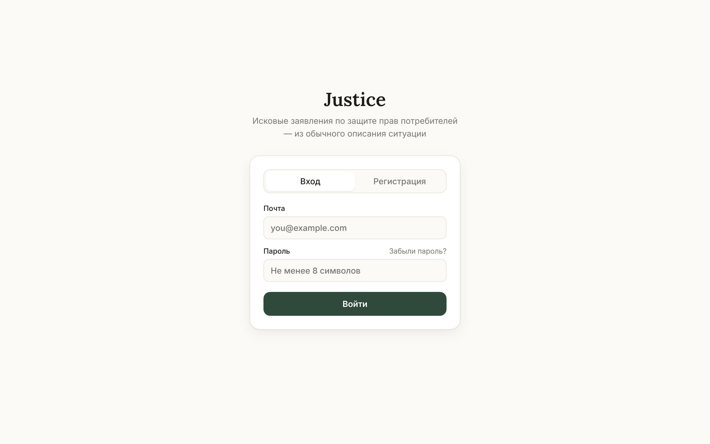
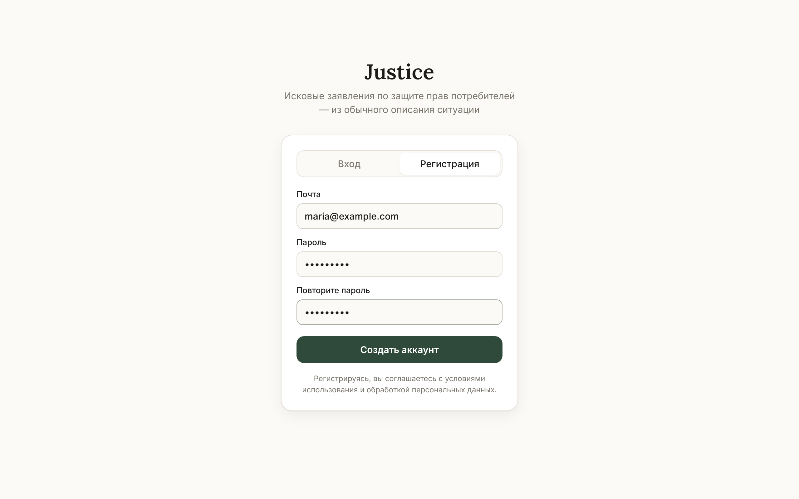
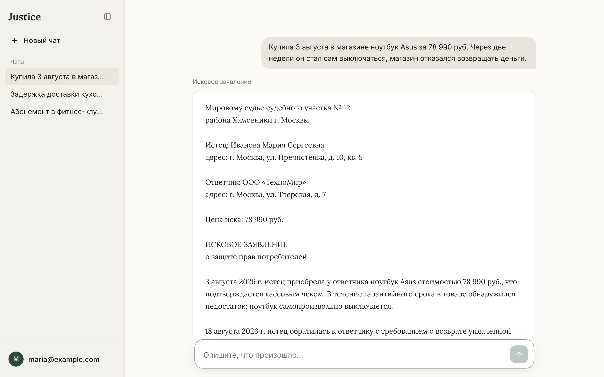
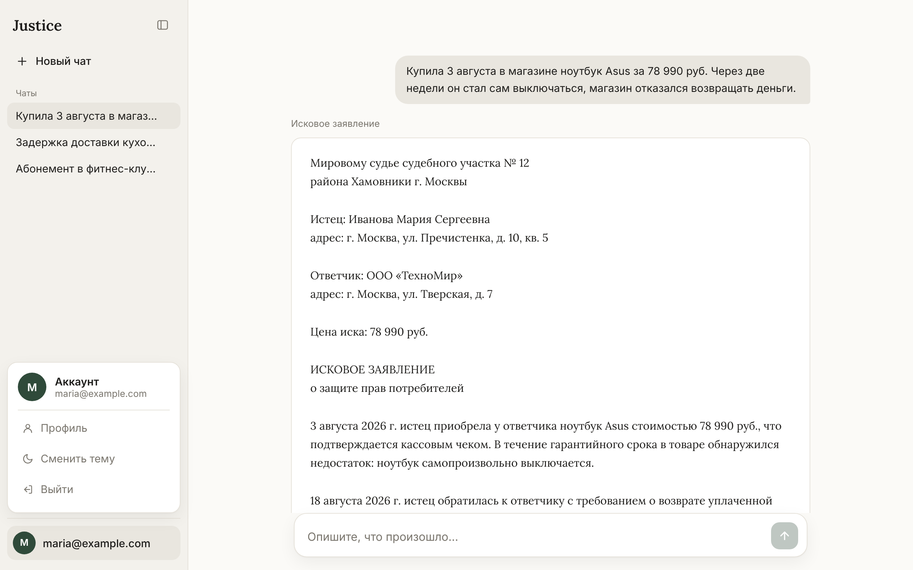
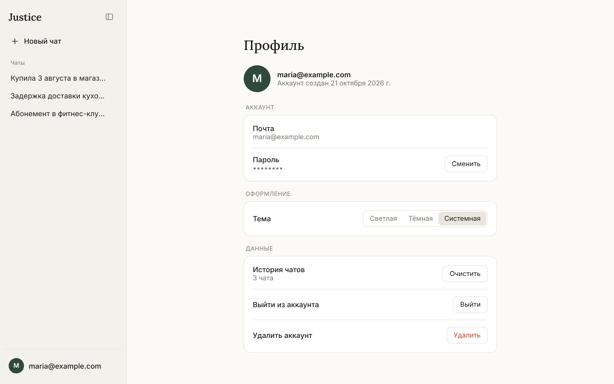

# Justice — фронтенд

Веб-интерфейс для генератора исковых заявлений **Justice**. Пользователь описывает ситуацию своими словами, а система на основе локальной LLM (Ollama + Mistral), векторной базы норм и веб-поиска готовит исковое заявление по защите прав потребителей.

Интерфейс сделан в привычном стиле чат-ассистента: одна строка ввода по центру, список чатов слева, профиль в левом нижнем углу.


---

## Возможности

- **Вход и регистрация** по почте и паролю
- **Чат с генерацией иска**: строка ввода по центру, после первого сообщения опускается вниз
- **История чатов** в боковой панели: переключение, удаление, «Новый чат»
- **Готовый иск** можно скопировать или скачать в `.txt` и `.docx`
- **Профиль**: почта, дата регистрации, смена пароля, выбор темы, очистка истории, выход и удаление аккаунта
- **Светлая и тёмная тема** (или автоматически, как в системе)
- **Адаптивная вёрстка**: на телефоне боковая панель выезжает поверх
- **Понятные ошибки**: если не запущен бэкенд или Ollama, интерфейс прямо говорит, что включить

---

## Скриншоты

### Вход и регистрация

| Вход | Регистрация |
|---|---|
|  |  |

### Генерация иска

Пользователь описывает ситуацию, пока модель работает, в чате видно, что идёт обработка.


Готовое исковое заявление выводится карточкой. Под ним кнопки «Копировать», «Скачать .txt» и «Скачать .docx».



### Профиль

По клику на почту в левом нижнем углу открывается меню аккаунта.





### Тёмная тема


---

## Стек

- **React 19** + **TypeScript**
- **Vite**: сборка и dev-сервер
- **React Router**: страницы `/login`, `/`, `/c/:id`, `/profile`
- Стили на чистом CSS (без UI-библиотек), шрифты Inter и Lora

---

## Запуск

Нужны:
- **Node.js 18+**: [nodejs.org](https://nodejs.org)
- запущенный **бэкенд** (`app/main.py`) на порту 8000
- запущенная **Ollama** со скачанными моделями `mistral` и `nomic-embed-text`

Понадобятся два окна терминала.

**Терминал 1. Бэкенд**

macOS / Linux:
```bash
cd JUSTICE/app
source .venv/bin/activate
python main.py
```

Windows:
```powershell
cd JUSTICE\app
.venv\Scripts\activate
python main.py
```

Готово, когда появится `Uvicorn running on http://0.0.0.0:8000`.

**Терминал 2. Фронтенд**

```bash
cd JUSTICE/frontend
npm install      # только при первом запуске
npm run dev
```

Откройте в браузере **http://localhost:5173**.

Чтобы остановить любой сервер, нажмите `Ctrl + C` в его окне терминала.

### Как фронт связан с бэкендом

Dev-сервер Vite перенаправляет запросы `/generate`, `/auth`, `/me` на `http://127.0.0.1:8000` (см. `vite.config.ts`), поэтому настраивать CORS в FastAPI не нужно.

```
Браузер (5173) → Vite → FastAPI (8000) → Ollama (11434)
```

---

## Частые ошибки

| Сообщение в чате | Что делать |
|---|---|
| Бэкенд не отвечает. Запустите FastAPI… | Запустите `python main.py` в папке `app` и проверьте, что открывается http://127.0.0.1:8000/docs |
| Не запущена Ollama… | Откройте приложение Ollama или выполните `ollama serve`; проверка: http://127.0.0.1:11434 |
| Модель не скачана в Ollama… | `ollama pull mistral` и `ollama pull nomic-embed-text` |
| `address already in use` в терминале | Порт занят старым запуском: `lsof -ti :8000 \| xargs kill` (или `:5173`) |

Генерация идёт локально и занимает от одной до нескольких минут: модель делает два прохода (извлечение фактов и написание иска).

---

## Авторизация

Пока в бэкенде нет аккаунтов, в `.env` стоит `VITE_MOCK_AUTH=true`: регистрация и вход хранятся прямо в браузере. Этот режим только для разработки, пароли в нём не защищены.

Когда бэкенд будет готов, поставьте `VITE_MOCK_AUTH=false` и перезапустите `npm run dev`. Фронт ожидает такие эндпоинты:

| Метод | Путь | Тело запроса | Ответ |
|---|---|---|---|
| POST | `/auth/register` | `{email, password}` | `{access_token}` |
| POST | `/auth/login` | `{email, password}` | `{access_token}` |
| GET | `/me` | — | `{email, created_at}` |
| POST | `/me/password` | `{current_password, new_password}` | 204 |
| DELETE | `/me` | — | 204 |

Токен передаётся в заголовке `Authorization: Bearer <token>`. Ошибки ожидаются в формате FastAPI (`{"detail": "текст"}`), текст показывается пользователю как есть.

Генерация использует уже существующий эндпоинт:

| Метод | Путь | Тело запроса | Что берёт фронт |
|---|---|---|---|
| POST | `/generate` | `{text}` | поле `isk` |
| POST | `/generate/docx` | `{text}` | файл `.docx` |

---

## Сборка для продакшена

```bash
npm run build      # результат в frontend/dist
```

Чтобы FastAPI сам отдавал собранный фронт на том же адресе, добавьте в конец `app/main.py` (после всех API-эндпоинтов, перед `if __name__ == "__main__"`):

```python
from fastapi.staticfiles import StaticFiles
from fastapi.responses import FileResponse

DIST = os.path.join(os.path.dirname(__file__), "..", "frontend", "dist")
app.mount("/assets", StaticFiles(directory=os.path.join(DIST, "assets")), name="assets")

@app.get("/{path:path}", include_in_schema=False)
async def spa(path: str):
    # все остальные пути отдаём index.html — маршрутами занимается React
    return FileResponse(os.path.join(DIST, "index.html"))
```

После этого всё приложение открывается на http://localhost:8000.

---

## Структура

```
frontend/
├── index.html
├── vite.config.ts          прокси на бэкенд
├── .env                    VITE_MOCK_AUTH
├── docs/screenshots/       скриншоты для README
└── src/
    ├── main.tsx            точка входа
    ├── App.tsx             маршруты и общий каркас (сайдбар + страница)
    ├── styles.css          все стили; цвета светлой и тёмной темы в начале файла
    ├── api/
    │   ├── client.ts       запросы к API, токен, понятные тексты ошибок
    │   ├── auth.ts         вход, регистрация, профиль (+ заглушка)
    │   └── generate.ts     /generate и /generate/docx
    ├── auth/
    │   └── AuthContext.tsx текущий пользователь
    ├── components/
    │   ├── Sidebar.tsx     список чатов
    │   ├── ProfileMenu.tsx меню профиля в левом нижнем углу
    │   ├── Composer.tsx    строка ввода
    │   ├── MessageView.tsx сообщения и карточка иска
    │   ├── Avatar.tsx
    │   └── Icons.tsx
    ├── lib/
    │   ├── ChatsContext.tsx история чатов
    │   ├── theme.ts        светлая / тёмная / системная тема
    │   ├── storage.ts      безопасная работа с localStorage
    │   └── format.ts       даты, склонения, скачивание файлов
    └── pages/
        ├── LoginPage.tsx
        ├── ChatPage.tsx
        └── ProfilePage.tsx
```

---

## Ограничения и планы

- История чатов хранится в браузере, отдельно для каждого пользователя. Чтобы перенести её на сервер, нужно поменять только `src/lib/ChatsContext.tsx`.
- Кнопка «Скачать .docx» вызывает `/generate/docx`, который генерирует иск заново, поэтому файл может отличаться от текста на экране. Лучше добавить в бэкенд эндпоинт, превращающий готовый текст в `.docx`.
- «Забыли пароль?» и смена почты требуют отправки писем и пока не реализованы.
- Ответ приходит целиком. Потоковый вывод (по мере генерации) появится, если бэкенд начнёт отдавать ответ через streaming.
